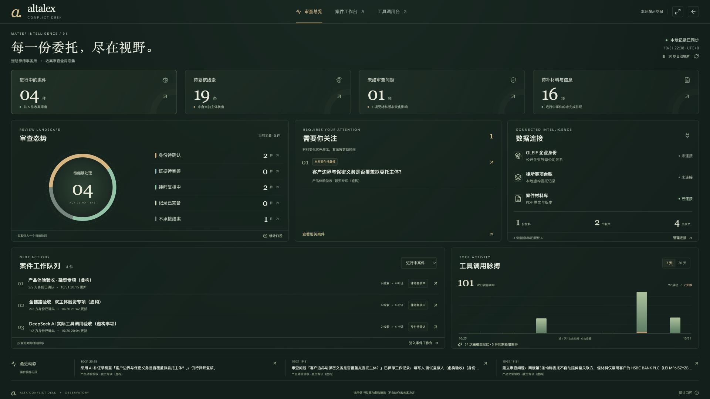
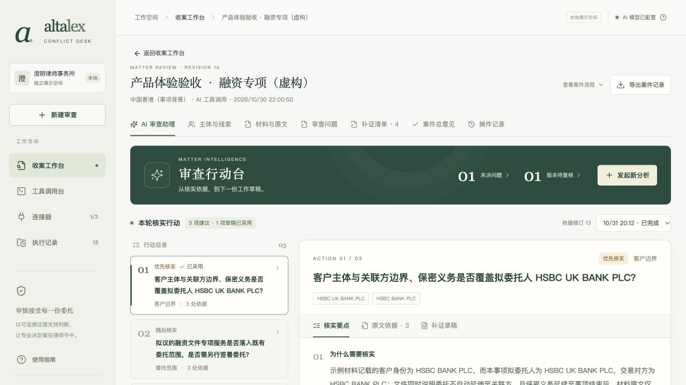
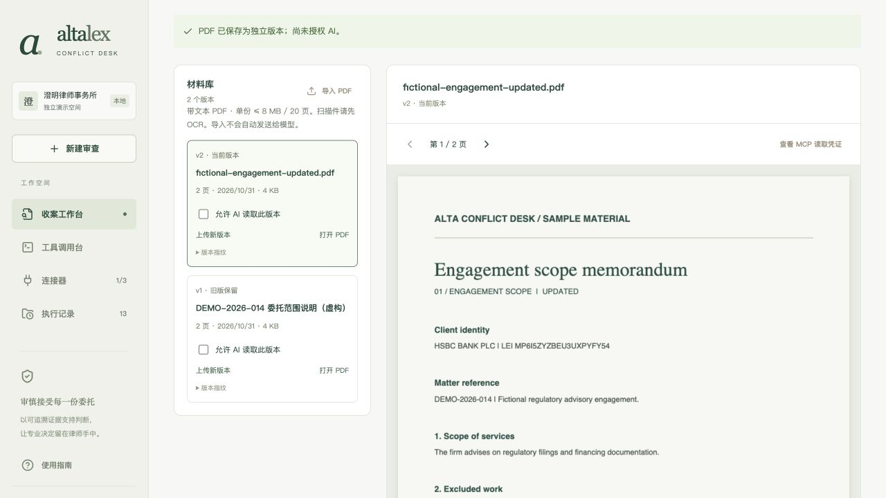
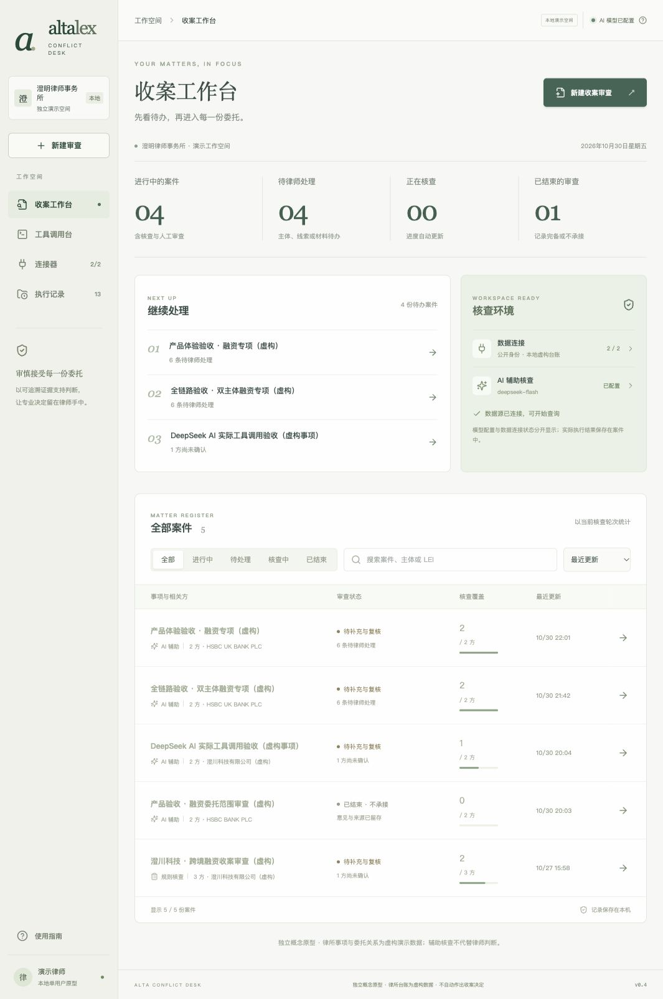

# Alta Conflict Desk · v0.9

面向律所收案环节的主体识别与潜在利益冲突核查原型。围绕一个具体问题：**新事项各方及其公开披露的母公司，是否出现在本所事项台账中；还有哪些身份、委托范围与保密义务需要律师核实？**

v0.9 新增「审查总览」数据大屏：墨绿与香槟金视觉、案件阶段环图、材料变化提醒、连接状态、可筛选工作队列、7／30 天真实留存调用趋势。支持全屏、30 秒自动刷新与暂停，点击进入对应案件处理。启动后打开 `/#/overview`，或点击侧栏「审查总览」。[本轮功能与统计口径](docs/PRODUCT-EXPERIENCE-V9.md)；65 项测试及生产构建通过。本轮只聚合已有记录，不新增模型调用。



v0.8 将 AI 审查助理改为「审查行动台」：左侧行动目录、右侧核实要点／原文依据／补证草稿；新分析与 PDF 核对在侧栏完成。压缩案件抬头、按需展开进度，保留草稿和历史分析；桌面、平板、手机经过浏览器检查。详见 [界面与交互升级](docs/PRODUCT-EXPERIENCE-V8.md)。本轮不新增模型调用，沿用 v0.7 的真实结果。



v0.7 新增真实 AI 审查助理：DeepSeek 经 2 轮、4 次模型 MCP 读取，生成 3 项带原文引用的行动；浏览器完成编辑、复制并采用到已有问题。首次失败记录保留，见 [功能说明](docs/PRODUCT-EXPERIENCE-V7.md)与[只读核验](docs/V7-ASSISTANT-VERIFICATION.json)。v0.7 的 62 项回归测试和生产构建通过。v0.6 的问题建立、版本影响、人工处理与 [Word 下载](docs/V6-REVIEW-MEMO.docx)保留为历史验收，各版本调用数分别计证。

v0.5 增加案件材料与原文复核：真实 PDF 导入、原文页预览、按版本授权 AI、带页码和 MCP 凭证的核实问题、不可覆盖的版本及摘录留存；主体匹配新增 LEI、名称、辖区逐字段解释。详见 [v0.5 功能与验收](docs/PRODUCT-EXPERIENCE-V5.md)。



**2026-10-31 已实跑材料 AI 流程。** DeepSeek 读取虚构委托说明的两页，实际发起 2 次材料 MCP 调用，产生 5 个待核实问题；原文引用、文件哈希及两版材料通过只读核验，保存了 1 条关联补证的演示摘录。见 [验收 JSON](docs/V5-MATERIAL-VERIFICATION.json)和[导出报告](docs/V5-CASE-REPORT.md)。这是新增材料流程；下方 12 次 GLEIF/台账模型调用仍为 v0.4 的历史验收。

v0.4 将入口整理为案件工作台：真实待办统计、搜索筛选、三步新建、当前标签页草稿暂存、可刷新返回的案件链接，以及案件进度与下一步提示。使用指南面向律师说明操作，技术集成资料放在折叠区。详见 [产品体验说明](docs/PRODUCT-EXPERIENCE-V4.md)。



v0.3 补齐律师审查处理路径：保留问题、不承接结案、意见与补证草稿、旧意见保留、主体更正和明确的下一步。新增结合委托背景的 AI 简报；来源卡由真实工具字段生成，摘要和建议保留人工复核边界。实现及产品取舍见 [产品化审查说明](docs/PRODUCT-REVIEW-V3.md)。

v0.2 将单主体查询深化为案件级工作流：最多六个企业主体、自动补证清单、逐项复核、总意见与变更留痕。同时增加独立工具调用台，让连接器权限、参数、真实调用与失败重试可见、可操作。

**新版界面已实际跑通双主体 AI 流程（2026-10-30）。** 从三步向导建立虚构融资案件，两家企业均完成 DeepSeek `deepseek-flash` 核查，每家 2 轮、6 次模型 MCP 调用，共 12 次；另有 8 次规则调用。来源字段、逐主体台账引用和 HTTP 回执通过加固检查，报告已通过浏览器下载。见 [v0.4 验收 JSON](docs/V4-PRODUCT-VERIFICATION.json)和[案件报告](docs/V4-CASE-REPORT.md)。仍有 6 条人工复核线索及 4 项补证，不代表获准收案。

前一轮 [GLEIF 超时修复](docs/GLEIF-RECOVERY.md)及 [v0.3 验收](docs/V3-AI-VERIFICATION.json)保留原记录；本轮没有覆盖历史证据。

2026-10-27 的单主体验收保留为历史：[旧 AI 实跑记录](docs/AI-LIVE-VERIFICATION.json)与[旧调用报告](docs/SAMPLE-AI-REPORT.md)，没有覆盖改写。

交付仓库：[Luyi210/alta-conflict-desk](https://github.com/Luyi210/alta-conflict-desk)（私有，评审者需要仓库访问权限）。

这是一款独立运行的面试原型，没有获取或修改 Alta Lex 源码。此前在测试账户与已查看产品文档中未发现同类收案入口；这不代表 Alta Lex 的所有版本均没有此能力。

## 核心流程

1. 从收案工作台查看待办与核查环境；连接 GLEIF 与本地示例台账，查看真实发现的 MCP 工具并测试连接。可到工具调用台独立验证查询。
2. 点击新建，按“事项信息 → 确认相关方 → 核查确认”三步建立案件。最多加入六个企业，逐一检索并确认法律名称、辖区与 LEI。未提交内容在当前标签页暂存，刷新或查看连接器后可继续；关闭标签页后不保证恢复。
3. 至少确认一个主体后可开始核查。已确认主体分别读取公开身份、母公司关系并比对台账；未确认主体继续保留在案件范围内，明确形成身份缺口。
4. 检查各方直接、关联和名称近似线索，展开来源与真实 MCP 调用。案件汇总覆盖进度、阻塞项与跨主体合并的补证待办。
5. 律师逐项记录复核理由，补充委托范围或既往保密义务的核实说明与材料引用。补证表单中的自由文本引用仍是人工记录；「材料与原文」页可导入 PDF，读取实际页码并保存经连续原文校验的摘录。
6. 在「审查问题」整理具体疑问，关联依据、责任人与处理意见。材料变化后对照两版并补充新版依据，保留意见历史；未决问题会阻塞审查记录完备。
7. 记录“待补充材料”“待合伙人进一步复核”或“审查记录完备”等总意见，导出案件报告或 Word 备忘录。补录身份、重跑、补证或复核变更会使旧总意见失效并恢复草稿，保留活动记录。

**结果是待审查线索，不是是否接受委托的法律结论。** 未命中不等于不存在冲突；关联企业命中也不自动构成利益冲突。

“审查记录完备”只表示系统范围内的记录已齐备；未确认身份、运行中、来源失败、必填补证未完成或线索仍待复核时不能选择。它不批准收案。“待合伙人进一步复核”是本地标记，不会发送通知；审查人姓名为手工填写，身份未验证。

## 独立工具调用台

工具目录与参数 schema 来自 MCP `tools/list`，界面提供律师可读的用途说明、动态表单、JSON 参数和原始定义。执行后展示实际状态、参数、结果、错误和耗时；失败重试创建新记录并保留关联。HSBC 示例按钮只填参数，不生成结果。

工具可独立启用或暂停，权限持久化并在同一后端调用入口约束**手动、规则与模型**。暂停不假称取消已开始的只读请求。首次未连接不预造工具；断开后可以查看上次发现的定义，但不能调用。具体操作见 [工具调用台说明](docs/TOOLS.md)。

## 真实接入与模拟范围

| 部分                           | 实现方式                                   | 范围                                                      |
| ------------------------------ | ------------------------------------------ | --------------------------------------------------------- |
| 公开企业身份                   | GLEIF 公开 API，由独立 MCP stdio 服务暴露  | 实时请求，失败明确报告，不用预设公开结果替代              |
| 企业关系                       | GLEIF 已披露的直接、最终会计合并母公司关系 | 不覆盖所有股东、自然人、实际控制人或全部集团成员          |
| 律所客户事项                   | 独立 SQLite MCP 服务，只读查询             | 查询与数据库真实运行；委托关系和事项记录全部虚构          |
| 案件、补证、人工复核与工具记录 | 本地 SQLite 持久化 | 单机单用户；保留人工记录与意见历史 |
| 案件材料 | PDF.js + 独立材料 MCP + 本地版本库 | 真实 PDF 解析和页面读取；内置委托文件全部虚构，AI 按版本授权 |
| 模型                           | 可选模型配置                               | 未配置时使用“规则预览”；不能将其作为“AI 实际调用 MCP”验收 |

案件内每个已确认 LEI 的企业都进入同样的核查流程，包含拟委托人。未确认主体不冒充已覆盖；它会阻塞“审查记录完备”。同一 LEI 不能重复添加，兼任角色需在事项背景说明。自然人、未登记 LEI 主体的替代身份渠道、历史更名、跨语言别名和集团全图属于后续扩展；司法辖区字段仅作背景，不自动适用当地职业规则。

## 本机启动

需要 Node.js 24 或以上、npm，以及访问 `api.gleif.org` 的网络。Node 24 自带 SQLite API，无需另装数据库。三个 MCP 连接器均不要求额外账户或 API key：GLEIF 为外部服务，台账和材料为本地工具。真实 AI 另需配置模型。

```bash
npm ci
npm run dev
```

打开 <http://127.0.0.1:5178>。前端通过 Vite 代理访问本机 API。首次启动后进入“连接器”，逐一连接并测试。

macOS 也可以运行根目录的 [启动原型.command](启动原型.command)，它会检查 Node 版本、在缺少依赖时执行 `npm ci`，然后启动开发服务。

构建并以单服务运行：

```bash
npm run build
npm start
```

构建模式打开 <http://127.0.0.1:4318>；此时 Express 同时提供 API 与 `dist/` 页面。后台进程需保持运行；按 `Ctrl+C` 停止。

本机生成的 `data/app.sqlite` 保存案件、单主体核查、补证、复核、工具权限及调用记录；`data/ledger.sqlite` 是示例台账。材料元数据、页文本、授权和复核记录在 `data/materials.sqlite`，原 PDF 在 `data/materials/`。这些运行数据不进入 Git。重启后记录与工具权限保留，MCP 连接需重新连接；被重启打断的核查或手动调用明确标记中断失败，可创建新的重试记录。v0.1 单主体历史继续保留。

## 材料复核的操作与限制

进入一个案件 → 「材料与原文」 → 连接材料工具 → 导入 PDF（或内置虚构示例） → 核对页面 → 勾选允许 AI 读取此版本 → 运行复核。点击 AI 引用可回到对应版本和页码，在提取文字中高亮摘录；补充核实说明后保存，可关联原补证项。保存依据不等于补证完成，仍须律师核实。

上传新版本保留旧文件和旧引用，自动撤回同份材料原有授权，新版默认不授权；相关补证重新待处理，旧总意见恢复草稿并保留历史。文件仅导入本机；启动材料 AI 后，本案背景、问题及授权版本原文才发送至配置的模型。撤回授权不撤回已发送数据。

支持带文本 PDF，单份最多 8 MB / 20 页，每案最多 30 个版本；单轮 AI 最多 4 份 / 12 页。不支持 OCR、加密 PDF、DOCX 或字符坐标级批注。引用校验只证明摘录来自实际读取的页面，不证明问题语义或法律判断正确。案件范围限制是单用户原型的服务端工具边界，不是生产多租户鉴权。

只读复验已有材料 AI 记录（不发送模型请求、不读取 `.env`；可选输出路径会保存材料和引用，真实案件请勿导出到仓库）：

```bash
npm run verify:materials -- <caseId>
```

本机示例案号 `745ef599-51c2-4b47-9199-d72d71636d72`；新克隆不含运行数据库，需要自行建立案件。两版内置虚构 PDF 位于 `output/pdf/`，新克隆可直接使用。

## 审查问题与 Word 交接

「审查问题」可手工创建或从补证/AI 建议导入。添加连续原文摘录后填写责任人、待补事项和说明；记录意见须解决待补信息，发生版本变化时另须关联新版依据并确认影响。「材料变更」先用 MCP 逐页对照，再可授权两版给 AI。导出的 Word 可编辑，但不回写系统，也不自动完成补证或批准收案；Word 阅读器需有中文字体。详见 [v0.6 操作说明](docs/PRODUCT-EXPERIENCE-V6.md)。

已有问题记录可用 `npm run verify:issues -- <caseId>` 只读核验，同样不加载 `.env` 或发送模型请求。若指定输出文件，真实案件内容不要保存到 Git 仓库。

## 可选模型配置

复制示例环境文件到本机 `.env`，按其中注释填写支持工具调用的模型接口，再重新启动后端：

```bash
cp .env.example .env
```

不要将密钥提交到 GitHub。`.env` 已加入忽略规则。Alta Lex 网页测试账户的 credits 不等于可供本地程序使用的模型 API 配额。

| 环境变量                | 用途                                                                                       |
| ----------------------- | ------------------------------------------------------------------------------------------ |
| `PORT`                  | 后端端口，默认 `4318`；开发模式的 Vite 代理也使用此端口，若更改须同步修改 `vite.config.ts` |
| `DATA_DIR`              | 本机数据目录，默认 `./data`                                                                |
| `PUBLIC_API_TIMEOUT_MS` | 公开接口单次超时，默认 `20000` 毫秒；最多两次，总预算最多 60 秒                                                  |
| `MODEL_API_KEY`         | 可选模型接口密钥，仅保存在本机                                                             |
| `MODEL_BASE_URL`        | 支持 Chat Completions function calling 的接口根地址；默认 `https://api.openai.com/v1`      |
| `MODEL_NAME`            | 模型服务提供的模型标识，须支持工具调用                                                     |

当前 AI 模式先执行确定性核查，再让模型通过白名单工具重新读取和交叉检查已确认主体，生成带实际调用引用的摘要。它不是不限范围的自主调查。页面“已配置”仅表示配置存在，不保证凭据、配额或服务连通；须实际运行验证。

启用模型后，选定主体、公开关系、命中台账与事项名称会发送给所配置的模型服务。演示请继续使用虚构事项；生产环境需另行确定模型与保密政策。

未配置模型时，连接管理、工具调用台、案件规则核查、补证、人工复核及报告仍可运行。本机现已实际验证 **模型发出工具调用 → 后端通过 MCP 执行 → 模型读取真实结果并引用**。配置存在、手动调用和规则模式本身仍不能作为 AI 验收证据；历史规则记录不因后来模型验证通过而变成 AI 记录。

### DeepSeek 官方接口

本机 `.env` 可使用 `MODEL_BASE_URL=https://api.deepseek.com` 和 `MODEL_NAME=deepseek-flash`，把密钥填入 `MODEL_API_KEY` 后重新启动后端。当前模型名及非思考工具调用格式依据 [DeepSeek 官方文档](https://api-docs.deepseek.com/guides/tool_calls/)（2026-10-27）。适配器对官方 DeepSeek 主机显式设置 `thinking.type=disabled`，避免多轮工具调用依赖未保存的思考内容；其他兼容接口不附加这个参数。

本次 `deepseek-flash` 实跑已完成；凭证以保存的模型执行状态、最新双主体 12 条 `initiator:model` 成功追踪及对应摘要引用为依据，区别于兼容性 mock 测试，也不是服务商账单的独立核验。密钥只存于 Git 忽略的本机 `.env`，不随仓库交付。使用其他模型或第三方中转仍需单独验证，不要将官方密钥填到未经确认的其他服务地址。

## 验证

```bash
npm test
npm run test:live
```

- `npm test`：覆盖主体匹配、输入校验、MCP 连接、案件覆盖、补证合并、总意见失效、持久化、工具权限、schema 校验、失败重试及模型适配边界等。模型适配测试使用 mock 响应验证协议与限制，**不是实际模型运行**。当次数量和结果以测试输出及验收记录为准。
- `npm run test:live`：在临时数据目录启动 API 与两个 MCP 服务，实时查询 GLEIF、执行核查、保存复核、检查报告下载和断开行为，然后关闭并清理临时数据库。它不依赖已启动的开发服务器，也不修改日常演示数据库。
- `npm run build`：TypeScript 检查与前端生产构建。
- `npm run verify:ai -- --case <id>`：只读核验本机已有案件的 AI 核查记录，不新建任务、不发送模型请求、不读取 `.env`；检查完成状态、两类来源的模型调用与摘要引用，写出 AI 验收 JSON 和报告。

最新双主体记录可这样只读复核（`--hardened` 另存 V3-AI-*，不覆盖旧验收）：

```bash
npm run verify:ai -- --case fe5bd2b5-c7e3-4440-835c-2a7729b6ff2e --hardened
```

对应两个 run 为 `6c62eeac-7faf-41ee-adee-d5afc830d0d6` 与 `32b3a553-a2e6-4b38-9e19-c811f345ce8a`。上述编号属于本机已有数据库；全新克隆不包含 `data/`，须先实际运行自己的 AI 案件，再传入其编号。该命令只重新检查已有证据，不重新消费模型调用。

实时脚本将当次结果写入 [LIVE-VERIFICATION.json](docs/LIVE-VERIFICATION.json)。该记录按脚本实际覆盖范围解释；基础规则流程通过不自动证明所有 v0.2 交互均已验收。外网失败会导致测试失败或明确缺口，不会切换成假数据。

安装构建、模型实跑、v0.2 浏览器验证、仓库同步和视频录制的最新证据见 [交付清单](docs/DELIVERY-CHECKLIST.md) 与 [浏览器验收记录](docs/BROWSER-VERIFICATION.md)。清单中待完成项目不应在演示或提交说明中被描述为已完成。

## 历史 DeepSeek AI 演示（2026-10-27）

当前功能验收见上面的双主体记录，本轮未录制视频。

[52 秒 AI 验收视频](docs/demo-ai-walkthrough.mp4)展示 2026-10-27 实跑的身份确认、完成状态、模型摘要、4 次模型发起的 MCP 调用及原始返回。视频为实际截图串联，**非连续录屏**；与之前纯规则视频分开保存。配套[字幕](docs/demo-ai-walkthrough.srt)、[截图来源及哈希清单](docs/demo-ai-walkthrough.json)，可选运行 `python3 scripts/render-ai-demo.py` 重建。

当时一个已确认主体的 AI 工具链路通过，案件中的拟委托人身份仍待补充，报告不是收案批准。模型复核后已通过浏览器保存演示人工意见并下载报告。

## 历史 v0.2 演示与验证（2026-10-27）

[72 秒新版截图演示](docs/demo-v2-walkthrough.mp4)展示多主体案件、补证、总意见阻塞和工具调用台，配套[字幕](docs/demo-v2-walkthrough.srt)与[来源校验记录](docs/demo-v2-walkthrough.json)。它是实际页面截图串联，**非连续录屏、非真实 AI 演示**。可选执行 `python3 scripts/render-v2-demo.py` 重建。

当时自动测试 **32 / 32 通过**，`npm run build` 通过；其中 mock、协议和记录核验测试与真实 DeepSeek 实跑分别计证。实际浏览器操作见[验收记录](docs/BROWSER-VERIFICATION.md)。两个新增实时脚本可独立复验：

```bash
npm run test:case-live
npm run test:tools-live
```

[案件验证](docs/CASE-LIVE-VERIFICATION.json)、[工具台验证](docs/TOOL-LIVE-VERIFICATION.json)保留原有规则/手动 MCP 事实，不改写为 AI 证据。另附[实际导出的案件报告](docs/SAMPLE-CASE-REPORT.md)，其中人工意见和引用仅为演示。独立的 [AI-LIVE-VERIFICATION.json](docs/AI-LIVE-VERIFICATION.json)记录本次 DeepSeek 实跑与仍存在的案件阻塞项。

## 演示草稿

[80 秒截图演示 MP4](docs/demo-walkthrough.mp4)串联了 **v0.1 单主体流程**的九张真实操作截图，并通过纵向平移展示长页面。**这是旧版截图演示草稿，不是连续录屏，不代表 v0.2 案件与工具台功能；使用规则模式，没有真实模型调用。** 视频无配音，带画面说明及可选中文软字幕，[字幕文件](docs/demo-walkthrough.srt)可单独使用。

最终提交前，须按更新后的 [v0.2 演示脚本](docs/DEMO.md)录制案件、补证、总意见与工具台的实际操作；完整题目的视频还须包含模型真实调用证据。旧截图视频不能代替上述验收。

可选重建视频：已有 Python 3、Pillow、FFmpeg 和中文字体时运行 `python3 scripts/render-demo.py`。这些是文档制作工具，不是应用运行依赖。脚本不安装系统软件；找不到中文字体时可用 `DEMO_FONT` 指定本机字体文件。

## 资料导航

| 文档                                           | 内容                                            |
| ---------------------------------------------- | ----------------------------------------------- |
| [简要方案](docs/PROPOSAL.md)                   | 用户、场景、交互、架构、取舍与未来融入方式      |
| [开源与文献研究](docs/RESEARCH.md)             | GitHub 项目、热度、许可、学习范围和一手规范来源 |
| [依赖与复用范围](docs/THIRD-PARTY-NOTICES.md)  | 实际安装版本、许可证与直接依赖用途              |
| [浏览器验收记录](docs/BROWSER-VERIFICATION.md) | 实际操作结果及响应式检查                        |
| [样例核查报告](docs/SAMPLE-REPORT.md)          | 实际规则运行导出的报告，内部委托数据虚构        |
| [AI 实跑证据](docs/AI-LIVE-VERIFICATION.json)  | 已保存模型执行状态、实际模型 MCP 调用与引用核验 |
| [AI 样例报告](docs/SAMPLE-AI-REPORT.md)        | 本次模型摘要、来源、原始调用与案件未完成项      |
| [核心演示脚本](docs/DEMO.md)                   | 录屏顺序、演示输入、异常分支和旁白要点          |
| [工具调用台](docs/TOOLS.md)                    | 真实工具发现、参数填写、权限、轮询与重试        |
| [AI 协作决策记录](docs/AI-COLLABORATION.md)    | 脱敏的沟通与决策摘要；非原始聊天逐字稿          |
| [交付清单](docs/DELIVERY-CHECKLIST.md)         | 可验证的验收项与当前缺口                        |
| [API 合约](docs/API-CONTRACT.md)               | 案件、工具台及保留的单主体接口与数据边界        |
| [v0.2 实现约定](docs/V2-CONTRACT.md)           | 案件与工具模块的职责和状态约束                  |

## 代码组织

```text
src/          React 页面、交互与样式
server/       API、MCP 客户端、核查任务、持久化
mcp/          GLEIF、SQLite 台账、案件材料三个独立 MCP 服务
shared/       前后端共享类型
tests/        自动化测试
scripts/      实时接入验证
docs/         方案、研究与交付资料
data/         本机生成的数据，Git 忽略
```

直接依赖包括 React、Vite、Express、Zod、Lucide、PDF.js 与官方 MCP TypeScript SDK；各自遵循原许可。参考其他项目的方法与界面思路，不等于复制其源码；具体范围见研究文档。项目没有打包 OpenSanctions 商业数据，也没有引入其完整搜索基础设施。
