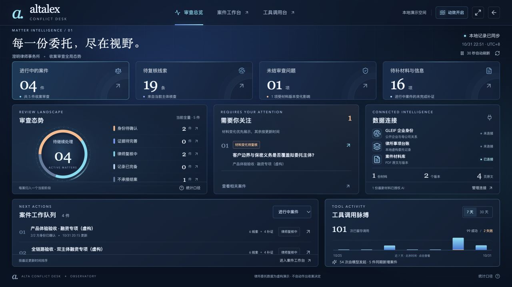

# Alta Conflict Desk

**律师收案前核查 · MCP 连接器与审查工作台**

律师收案前，需要确认各方究竟是哪一个法律主体、律所是否已有相关事项，以及委托材料是否足以支持审查意见。这个工作台把公开企业信息、本机示例台账、委托材料和律师处理记录放在同一宗案件中，供律师逐项核对来源、补齐缺口并交接。

当前为 **v0.9.1 本机原型**。页面右上角提供可随时重开的「7 步教程」；系统记录待核实线索和处理过程，是否承接委托由律师决定。



*当前深蓝色审查总览；图中的案件与数字是截图时的演示记录。*

## 评审从这里开始

| 想看什么 | 入口 |
| --- | --- |
| 先看完整操作 | [10 页图文说明书（PDF）](output/pdf/Alta-Conflict-Desk-使用说明.pdf) · [文字版](docs/USER-GUIDE.md) |
| 在本机跑起来 | 安装 Node.js 24+，执行 `npm ci`、`npm run dev`，打开 `http://127.0.0.1:5178/`；详见[运行指南](docs/OPERATIONS.md) |
| 看场景、取舍与集成路径 | [简要方案](docs/PROPOSAL.md) |
| 核对真实 MCP 与 AI 调用 | [验收记录](docs/FINAL-ACCEPTANCE-20261101.md) · [交付清单](docs/DELIVERY-CHECKLIST.md) |
| 看参考与开发过程 | [开源研究](docs/RESEARCH.md) · [复用范围](docs/THIRD-PARTY-NOTICES.md) · [脱敏 AI 沟通记录](docs/AI-CONVERSATION-REDACTED.md) |

代码、前后端、三个 MCP 服务、操作说明和验收凭证均已提交。**当前版本的连续演示视频尚未录制。**仓库不包含模型密钥和开发机案件数据；配置自己的模型后才能重新运行 AI 工具调用。历史验收凭证可用于核对已完成的真实调用。

## 一宗事项怎样处理

1. 在「连接器」连接 GLEIF、示例台账和案件材料；在「工具调用台」查看实际发现的工具、参数与权限。
2. 建立事项，登记最多六个企业。按法律名称、LEI 和辖区核对并确认主体，再执行核查。
3. 逐条查看公开来源、台账命中、匹配解释及调用记录；对委托范围和既往保密义务留下待核实项。
4. 导入带文本的 PDF，授权指定版本供模型读取。打开建议所引的原文和页码，编辑后再采用到审查问题。
5. 记录补证、责任人和人工意见。材料换版时复核受影响的问题，最后导出 Markdown 案件报告或 Word 备忘录。

## 页面与能力

| 页面 | 用途 |
| --- | --- |
| 案件工作台 | 建立和筛选事项、确认主体、查看核查范围与待办 |
| 连接器与工具调用台 | 连接、测试、停用工具；按实际 schema 填参，查看原始结果、失败和重试记录 |
| 案件审查 | 核对来源与原文、处理材料版本、补证、审查问题和律师意见 |
| 审查总览 | 汇总已有案件、待办、材料变化和 7／30 天调用记录，支持跳转到事项 |

模型可在限定范围内调用工具并起草核实要点。工具返回、引用和律师最终采用的文字分别留存；“审查记录完备”仅指系统范围内记录齐备。

## 接入范围

| 来源 | 如何接入 | 使用边界 |
| --- | --- | --- |
| GLEIF | MCP 服务请求公开 API | 查询 LEI 主体和已披露的会计合并母公司；不等于完整集团关系 |
| 示例台账 | MCP 服务查询本机 SQLite | 工具真实运行，客户及事项内容均为虚构 |
| 案件材料 | MCP 服务读取本机 PDF | 保留页码、版本与授权；内置材料为虚构样本 |

模型接口由本机 `.env` 配置；未配置时仍可进行规则核查和人工审查。2026-11-01 的虚构案件验收记录了 **12 次主体核查和 2 次材料读取的模型发起 MCP 调用**，另有 8 次规则调用。此前独立安装验收时 65 项测试通过；当前测试集为 **68 项，全部通过**，生产构建也通过。[查看验收及限制](docs/FINAL-ACCEPTANCE-20261101.md)。这些是当次记录，不表示启动时会自动重跑。

## 本机启动

需要 **Node.js 24+** 和 npm。进入本仓库目录：

```bash
npm ci
npm run dev
```

打开 [案件工作台](http://127.0.0.1:5178/) 或 [数据大屏](http://127.0.0.1:5178/#/overview)。macOS 可双击 [启动原型.command](启动原型.command)。

使用模型需配置本机 `.env`；初次配置可从 `.env.example` 复制，已有 `.env` 不要覆盖。密钥不进 Git。模型、运行数据与复验命令详见 [运行指南](docs/OPERATIONS.md)。

构建模式：`npm run build` 后执行 `npm start`，访问 `http://127.0.0.1:4318`。重启后记录保留，MCP 需重新连接。

## 文件夹怎么看

| 路径 | 用途 |
| --- | --- |
| `src/`、`server/`、`mcp/`、`shared/` | 前端、后端、三个 MCP 服务与共享类型 |
| `tests/`、`scripts/` | 自动测试、只读核验、接入验证及历史视频制作脚本 |
| `examples/pdf/` | 两版内置虚构材料；应用与测试需要，保留 |
| `docs/` | 当前资料、凭证与截图，见 [资料索引](docs/README.md) |
| `docs/history/` | 旧版说明、旧演示媒体与清理前文档 |
| `.env`、`data/` | 本机模型配置、案件数据库和导入材料；Git 忽略，清理时保留 |
| `node_modules/`、`dist/` | 前者是本机依赖；后者执行 `npm run build` 后生成，均不进入 Git |

## 交付导航

- [简要方案](docs/PROPOSAL.md)：用户、场景、实现取舍和未来集成。
- [交付清单](docs/DELIVERY-CHECKLIST.md)：完成项、证据与剩余工作。
- [代码检查](docs/CODE-REVIEW-2026-11-01.md)：本轮修复与验证范围。
- [AI 沟通记录](docs/AI-COLLABORATION.md)与[脱敏原文](docs/AI-CONVERSATION-REDACTED.md)：项目过程说明与可见对话导出。
- [开源研究](docs/RESEARCH.md)与[复用范围](docs/THIRD-PARTY-NOTICES.md)：学习范围、依赖和许可。
- [演示顺序](docs/DEMO.md)：待录制的新版本核心流程。
- [GitHub 公开仓库](https://github.com/Luyi210/alta-conflict-desk)：评审者可直接查看和克隆。

独立运行，没有获取或修改 Alta Lex 源码。当前为单机单用户原型，尚未实现多租户鉴权、生产级权限与审计、真实律所系统接入、OCR 或自动法律结论。
