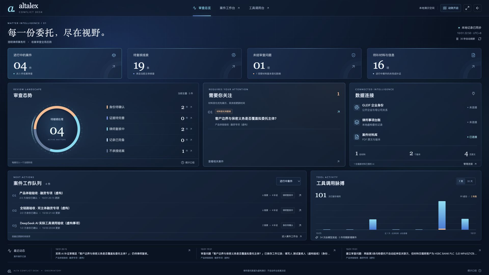

# Alta Conflict Desk · v0.9.1

面向律师收案环节的**主体身份与潜在利益冲突审查工作台**。将公开企业信息、本所事项台账、案件材料、AI 核实建议与人工审查连接到同一份可追溯记录中。

**当前进度（2026-11-01）：核心流程已实现，真实 AI → MCP 调用已实跑，处于可演示的本机原型阶段。** 最新连续操作视频、原始 AI 聊天脱敏导出和指定评审者的仓库访问权限仍待收尾。



## 已有功能

| 模块 | 实际可以做什么 |
| --- | --- |
| 审查总览 | 当前案件与待办指标、阶段环图、材料变化提醒、7／30 天调用趋势、案件跳转、全屏、自动刷新与动效开关 |
| 案件工作台 | 搜索筛选、三步新建、每案最多六个企业、身份确认、草稿暂存与案件链接 |
| 主体与关联核查 | GLEIF 法律名称、LEI、辖区及已披露会计合并母公司查询；对照台账，解释直接、关联与近似名称线索 |
| 连接器与工具台 | 三个真实 MCP 服务的连接、测试、断开、工具发现；schema 参数表单、逐工具权限、实际执行、原始结果与失败重试 |
| 材料与原文 | 文本 PDF 导入、页面预览、版本保留、按版本授权 AI、连续原文摘录及页码／调用凭证追溯 |
| AI 审查行动台 | 根据案件和授权材料实际调用工具，生成核实要点、材料缺口与补证草稿；可编辑、复制、采用到问题 |
| 问题与人工处理 | 问题责任人、支持／矛盾依据、待补事项、材料版本对照、变更影响、人工意见与历史留痕 |
| 报告与交接 | Markdown 案件报告、可编辑 Word 备忘录、活动与调用记录；变更使旧总意见失效并保留历史 |

结果是待核实线索与审查辅助，不自动决定是否承接委托。“审查记录完备”只表示系统范围内记录齐备。

## 完整使用路径

1. 在「连接器」连接 GLEIF、律所台账及案件材料；到「工具调用台」查看工具与权限。
2. 新建事项，检索、核对并确认各企业身份，运行规则核查或 AI 核查。
3. 查看命中来源和实际 MCP 记录，整理身份、委托范围及保密义务待核实项。
4. 导入 PDF 并授权指定版本；让 AI 提出带原文依据的行动，人工编辑并采用。
5. 补证、处理材料变更、记录审查意见，导出报告或 Word 备忘录。

## 真实接入与演示边界

| 接入 | 运行方式 | 数据边界 |
| --- | --- | --- |
| GLEIF | 独立 MCP 服务实时请求公开 API | 外部服务；覆盖 LEI 企业及已披露母公司，失败明确报告 |
| 律所台账 | 独立 MCP 服务查询本机 SQLite | 查询真实运行，内部客户／委托事项全部虚构 |
| 案件材料 | 独立 MCP 服务读取本机 PDF 页文本 | 真实文件解析、版本与授权限制；内置材料虚构 |
| 模型 | 后端执行模型工具调用循环 | 已有 DeepSeek 实跑；未配置时仅规则预览 |

已有证据：

- **2026-10-30 双主体核查：**12 次模型 MCP 调用，另有 8 次规则调用。[核验记录](docs/V4-PRODUCT-VERIFICATION.json)
- **2026-10-31 AI 审查助理：**2 轮、4 次模型 MCP 读取、3 项行动。[核验记录](docs/V7-ASSISTANT-VERIFICATION.json)
- **2026-10-31 最近代码验证：**v0.9 的 65 项测试通过；v0.9.1 生产构建、桌面／手机与动效检查通过。[交付清单](docs/DELIVERY-CHECKLIST.md)

以上保留原验收日期，不代表每次启动自动重跑。2026-11-01 整理只读检查本机状态，没有新增 AI 请求。

## 本机启动

需要 **Node.js 24+** 和 npm。进入本仓库目录：

```bash
npm ci
npm run dev
```

打开 [案件工作台](http://127.0.0.1:5178/) 或 [数据大屏](http://127.0.0.1:5178/#/overview)。macOS 可双击 [启动原型.command](启动原型.command)。

真实 AI 需配置本机 `.env`；初次配置可从 `.env.example` 复制，已有 `.env` 不要覆盖。密钥不进 Git。模型、运行数据与复验命令详见 [运行指南](docs/OPERATIONS.md)。

构建模式：`npm run build` 后执行 `npm start`，访问 `http://127.0.0.1:4318`。重启后记录保留，MCP 需重新连接。

## 文件夹怎么看

| 路径 | 用途 |
| --- | --- |
| `src/`、`server/`、`mcp/`、`shared/` | 前端、后端、三个 MCP 服务与共享类型 |
| `tests/`、`scripts/` | 自动测试、只读核验、接入验证及历史视频制作脚本 |
| `output/pdf/` | 两版内置虚构材料；应用与测试需要，保留 |
| `docs/` | 当前资料、凭证与截图，见 [资料索引](docs/README.md) |
| `docs/history/` | 旧版说明与清理前文档 |
| `.env`、`data/` | 本机模型配置、案件数据库和导入材料；Git 忽略，清理时保留 |
| `node_modules/`、`dist/` | 已安装依赖与构建产物；Git 忽略，本机运行所用 |

## 交付导航

- [简要方案](docs/PROPOSAL.md)：用户、场景、实现取舍和未来集成。
- [交付清单](docs/DELIVERY-CHECKLIST.md)：完成项、证据与剩余工作。
- [AI 沟通摘要](docs/AI-COLLABORATION.md)：脱敏摘要，非完整逐字聊天。
- [开源研究](docs/RESEARCH.md)与[复用范围](docs/THIRD-PARTY-NOTICES.md)：学习范围、依赖和许可。
- [演示顺序](docs/DEMO.md)：待录制的新版本核心流程。
- [GitHub 私有仓库](https://github.com/Luyi210/alta-conflict-desk)：评审者需要访问权限。

独立运行，没有获取或修改 Alta Lex 源码。当前为单机单用户原型，尚未实现多租户鉴权、生产级权限与审计、真实律所系统接入、OCR 或自动法律结论。
