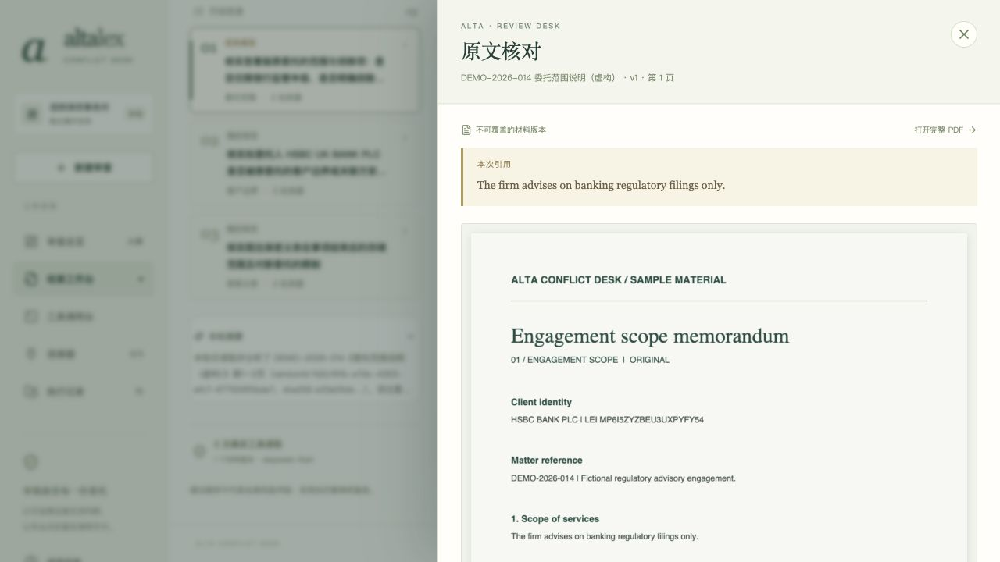
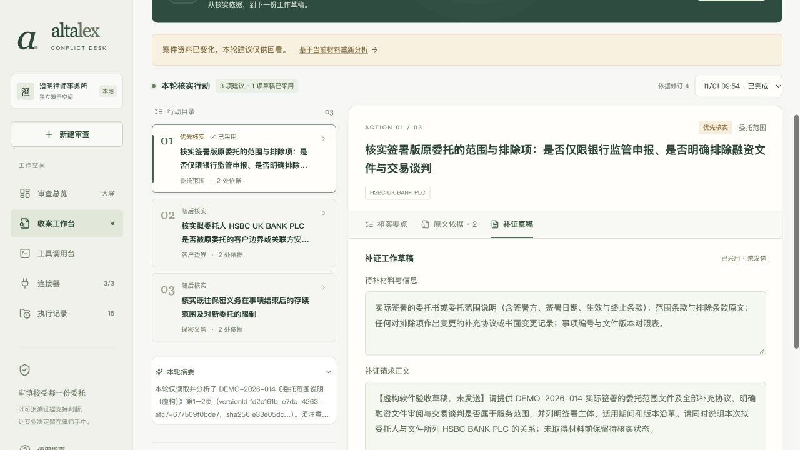

# 本轮交付验收 · 2026-11-01

> 本文记录当日验收。此后按用户要求移除 Word 导出功能及仓库中的 Word 样本；当前可用功能见[交付清单](DELIVERY-CHECKLIST.md)。

结论：v0.9.1 的本机运行与核心律师工作流程通过本轮验证。没有发现阻断本轮流程的新问题，未改动业务代码。视频依用户最新指示暂缓；评审访问仍等待指定 GitHub 用户名。

## 干净安装与启动

从提交 `7e241da02f4f1a0b3a18d7b89ab0ec4d75516c50` 导出独立临时目录，不复制 `.env`、`data/` 或 `node_modules/`。使用新 npm 缓存安装 211 个包，65 项测试全部通过，TypeScript 与 Vite 生产构建通过。

构建后在独立 4320 端口运行 `npm start`：页面与 API 正常，模型显示未配置，初始案件为 0；真实本地台账 MCP 连接与测试通过。结束后关闭临时进程，日常 5178／4318 原型继续运行。[安装凭证](FINAL-CLEAN-INSTALL-20261101.json)

自动测试包含模型 mock；真实模型验收另行记录，不能将测试数量当作模型调用次数。

## 浏览器实际流程

使用新案件「交付验收 · 融资收案审查（虚构 · 2026-11-01）」，编号 `a0f550f6-2bbe-42b8-9c04-f14ebd746f3d`。企业名称用于公开身份检索，委托、交易、台账和人工复核说明全部为虚构演示。

| 操作 | 本轮观察 |
| --- | --- |
| 连接与身份确认 | 连接 GLEIF、台账及材料，GLEIF 真实测试通过；从三步向导检索确认两家企业 |
| AI 主体核查 | 两个主体均完成，每方 2 轮／6 次模型 MCP 调用，共 12 次；另有 8 次规则调用 |
| 材料导入与授权 | 导入实际两页 PDF，默认未授权；人工勾选授权 v1 后才进入 AI 分析 |
| AI 审查助理 | DeepSeek 实际读取两页，2 轮／2 次 MCP 调用，生成 3 项行动；本案无失败分析尝试 |
| 引用与草稿 | 打开对应 PDF 原文；编辑正文、复制核对一致，采用 1 项为问题并附 2 条引用 |
| 人工复核 | 保存虚构责任人和工作说明；保留待补信息，记录「待补充材料」总意见 |
| 材料变更 | 导入 v2 后保留两版，原授权撤回、新版未授权；问题提示变更，总意见恢复草稿，旧文字与活动记录保留 |
| 差异比较 | 实际 MCP 逐页读取两版，共 4 次人工发起读取；显示变化及关联问题，不混算成模型调用 |
| 导出与恢复 | 浏览器实际下载 Markdown 与 Word；核对 DOCX ZIP／XML、案件信息、人工正文和引用。刷新后已采用正文仍在 |

浏览器刷新后已采用的编辑正文保持一致，错误日志为空；390px 手机视口下文档宽度仍为 390px，没有横向溢出，检查后恢复默认桌面。

本轮真实模型发起的 MCP 调用合计 **14 次**：主体 12 次＋材料助理 2 次。UI 查看原文、连接测试、规则核查和人工比较单独计数。已通过来源、网络回执、PDF 哈希、页文本、引用与采用正文的只读校验。[完整流程凭证](FINAL-FLOW-VERIFICATION-20261101.json)

## 文件与复验入口

- [主体 AI 核验](FINAL-AI-VERIFICATION-20261101.json)与[模型报告](FINAL-AI-REPORT-20261101.md)
- [材料助理核验](FINAL-ASSISTANT-VERIFICATION-20261101.json)与[问题引用核验](FINAL-ISSUES-VERIFICATION-20261101.json)
- [实际下载案件报告](FINAL-CASE-REPORT-20261101.md)
- [脱敏沟通原文](AI-CONVERSATION-REDACTED.md)：34 回合／210 条用户及助手公开消息，不含系统配置、内部推理和工具原始输出；与协作摘要分开保存

这些凭证独立命名，未覆盖旧版本。新克隆不含本机数据库，需要自己建立案件；以下链接仅适用于开发机现有数据：[打开本轮验收案件](http://127.0.0.1:5178/#/cases/a0f550f6-2bbe-42b8-9c04-f14ebd746f3d?tab=assistant)。

## 仍保留的边界

案件仍有 6 条线索、4 项补证及 1 个受材料变化影响的问题待处理，总意见为草稿。这证明系统正确保留未决状态，不代表真实客户材料齐备或获准收案。

Word 本轮验证结构与内容；未重新做所有阅读器的分页兼容测试。模型来源依据本机真实执行记录，不是服务商账单的独立核验。原型仍是单机单用户，不能据本轮验收宣称生产上线就绪。

已只读核对 GitHub 仓库为私有，当前可见协作者只有仓库所有者 `Luyi210`。尚未邀请任何评审者；收到明确用户名后再确认访问。
