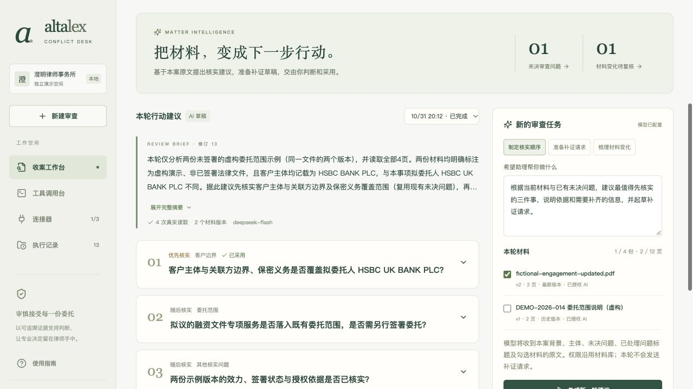
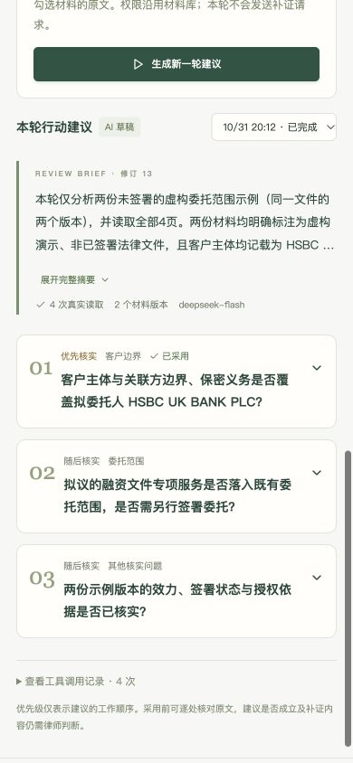

# v0.7 · 有原文依据的 AI 审查助理

2026-10-31。本轮回应“更智能、更方便实用、展示更具体美观”：让收案经办律师从材料核实直接走到可编辑的补证工作草稿。没有增加通用聊天模块或第二套案件系统。

## 操作流程

1. 案件进入「AI 审查助理」。选择制定核实顺序、准备补证请求或梳理材料变化，也可改写具体要求。
2. 勾选已授权的材料版本，每次最多 4 份、12 页。缺少授权或连接时在此处处理；沿用版本授权和全局工具权限，新版仍须重新授权。
3. AI 获得本案背景、主体、未决问题和已处理问题标题，通过真实 MCP 逐页读取选定 PDF。页面展示真实读取数、运行状态和历史尝试。
4. 生成最多 3 项行动：具体问题、建议顺序、理由、相关主体、材料缺口、补证请求正文、原文引用。优先关联已有未决问题，可查看对应 PDF 页、提取文字和调用凭证。
5. 律师编辑或复制正文，再选择补充到已有问题或采用为新问题。采用会追加文字、关联并去重原文、保留旧意见历史，问题进入复核中。不发送请求、不自动完成补证、不批准收案。
6. 采用后的编辑文字单独持久化，刷新或切换页面仍显示已采用版本。未采用编辑按当前标签页暂存。案件发生其他变化后，旧建议仅供回看，后端拒绝直接采用；同一轮连续采用不会被自己的正常追加阻塞。



## 智能能力的具体实现

- 案件上下文复用，模型输出只能关联本轮提供的未决问题 ID 和本案主体 ID。已处理问题标题用于减少重复工作；是否属于同一问题仍由模型建议、律师确认。
- 复用材料工具循环，模型只能调用 read_material_page，后端绑定 caseId/access。必须读完选定页，最多 5 轮/16 次请求，每轮最多 6 次，每次模型请求 60 秒超时。
- 提供 JSON Schema 与实际凭证索引，格式错误给出字段级反馈、最多修正一次。引用造假、错案或越权不能靠格式重试放宽。每项行动至少一处引用，每个选定版本至少被引用一次。
- 保存前检查案件修订、文字长度、原文和幂等键。不会覆盖原文字、产生自动法律意见或清除版本变化提醒。
- 行动卡片、折叠摘要、工作顺序标签、相邻的依据和草稿；页面按需加载，手机使用单栏布局。

这里没有模型微调、长期自主记忆或全案自动法律判断。价值在于连接真实上下文、工具读取、引用约束和人工采用。

## 实际验收

继续使用虚构案件 745ef599-51c2-4b47-9199-d72d71636d72，没有上传真实客户文件或发送请求。

- 第一次真实尝试 4566cd3e-6950-4178-a2ce-0713550df2f5 已读 4 页，但两次结果格式校验未通过，保持失败且没有写入问题。此次未保存具体格式错误字段，不能事后断言哪一字段出错。
- 补充明确 JSON Schema 与字段级修复反馈后，第二次 5abdd51b-478c-44e4-9af3-e4d3b188ccc2 于 20:12 完成：DeepSeek deepseek-flash、2 轮、4 次成功模型 MCP 调用、3 项行动、0 次格式修复，约 12 秒。仅代表此次运行，不保证所有兼容模型输出稳定。
- 浏览器编辑第一项客户边界建议，正文明确标注虚构验收，测试复制并追加到已有问题。案件修订 13→14；该问题依据 4→6 条，重复引用未增加；原说明保留、材料变化提醒保留，总意见仍是草稿。
- 打开实际 PDF 第 1 页；到问题页核对原说明与补证草稿同时存在，再返回助理核对编辑文字仍在。390px 手机宽度下文档宽度也是 390px，检查后恢复桌面视口。
- 62 项自动测试通过。新增覆盖真实本地 MCP + mock 模型、跨案/伪造引用/未知主体与问题拒绝、权限撤回、采用幂等、旧修订拦截、历史意见保留及重启恢复。mock 测试与真实 DeepSeek 分开计证。
- [只读核验记录](V7-ASSISTANT-VERIFICATION.json)检查读取记录、全部页覆盖、PDF 哈希与文字、引用和已采用草稿快照，不读取 .env、不调用模型。这是应用记录核验，不是账单或法律正确性证明。
- TypeScript 与生产构建通过。保留两条 Zod 上游 PURE 注释提示；新助理拆分为按需加载模块。



## 范围、复用与融入 Alta Lex

优先级是建议的工作顺序，不是法律风险评级；引用匹配通过不等于推论成立。依旧是本机单用户原型，没有认证律师身份、协同审批、自动邮件、扫描件 OCR 或法律库检索。本轮助理只调用材料 MCP；既有 GLEIF 与台账链路及验收日期保持原记录，不把本地工具称作新外部云服务。

采用后的内容进入现有问题导出；未采用的助理历史保存在本机与页面历史下拉框中，本轮未增加历史建议的通用报告导出。案件与材料分属两份 SQLite，跨库操作不是生产级事务；正式接入应使用宿主统一事务、鉴权、审计和模型网关。

本轮没有新 npm 依赖，复用既有 MCP 材料引擎、版本授权、引用校验、问题服务和草稿暂存；依赖与许可范围仍见 THIRD-PARTY-NOTICES.md。frontend-design 用于层次与响应式，product-manager-toolkit 用于工作流优先级。未复制 Alta Lex 源码。

未来作为 Alta Lex 案件页插件，映射宿主事项、文档版本、用户和模型权限；保留生成草稿与律师采用两个动作，接收版本更新事件使旧建议失效。工具循环可迁移至宿主编排层，页面无需训练专有模型。

```bash
npm ci
npm test
npm run build
npm run dev
# 完成本机演示后只读核验；新克隆没有运行数据库。
npm run verify:assistant -- <caseId> [输出JSON路径]
```
