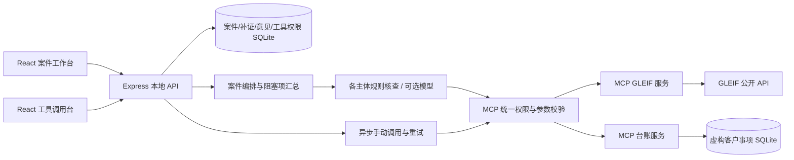

# 简要方案：案件级收案审查与 MCP 工具台（v0.2）

## 1. 谁在什么时刻使用

目标用户是负责新事项登记的律师、收案人员与复核合伙人。使用时刻位于接受委托之前：律师需要确认拟委托人、交易对方、担保方等各方究竟是哪家法律实体，并检查其与本所既有事项的关系。

实际困难包括名称不准确、同名企业、集团关系不易看见、公开信息与内部台账分散，以及各方身份、委托范围和保密义务的材料未齐。单独列出几个命中不能帮助律师判断核查是否完整，排除理由也需要留下依据。

本产品将「各方身份确认 → 真实工具取证 → 逐项复核与补证 → 案件总意见」放在同一份可追溯记录中。v0.2 的重点是覆盖缺口与人工判断的闭环，不是增加一个自动“无冲突”结论。

## 2. 为什么选这个场景

它有明确的律师工作入口，也自然需要连接两个来源：外部身份信息和内部客户事项系统。来源失联、工具被暂停或身份未确认，都会真实影响核查，连接器管理直接参与业务流程。

此前在 Alta Lex 测试账户及已查看文档中，看到了研究、合同审阅、起草、批量文档、项目与知识库等能力，未发现对应的收案核查入口。本方案依据这一观察提出可补充的工作流，不声称了解其全部版本、内部路线图或未开放功能。

## 3. 页面与使用流程

### 连接器管理

- GLEIF：说明公开身份、会计合并母公司关系、传出字段及覆盖限制。
- 律所示例台账：说明本机 SQLite 只读访问、虚构委托数据性质。
- 连接、测试、断开均操作实际 MCP 服务；工具列表来自发现结果。
- 模型配置状态与实际运行分开显示。无 API 时仍可运行规则预览，但不宣称完成 AI 实跑。

### 案件工作台

- 登记事项名称、背景与辖区，加入一至六个企业，选择拟委托人、交易对方、担保方或其他相关方角色。
- 对每个企业检索 GLEIF，核对法律名称、LEI、登记辖区等信息，再由用户确认。
- 至少确认一个主体后允许开始核查；未确认的主体保留在范围内，形成身份待办并阻塞“审查记录完备”。没有 LEI 不等于企业不存在。
- 同一 LEI 不能重复加入，兼任角色写在事项背景中，避免重复计数。
- 每个已确认主体执行独立核查，案件汇总覆盖进度、线索、未完成来源与待补材料。拟委托人也使用同样流程。

### 案件结果、补证与总意见

- 按主体查看直接命中、关联主体线索及名称近似线索，保留证据链接与实际调用追踪。
- 根据真实结果生成身份、来源、委托范围、既往保密义务四类补证待办。同一内部事项跨主体合并，避免重复索要同一份材料。
- 身份与来源缺口由系统状态管理，不能通过勾选完成；需要补录确认身份或修复后重跑。人工补证完成必须有核实说明和材料引用，**引用仅保存文本，不代表文件上传或真实性验证**。
- 律师逐条记录进一步复核、排除或撤回理由，再记录案件总意见。待补充、待合伙人进一步复核均只是本地状态；没有消息发送或真实审批系统。
- “审查记录完备”要求当前系统阻塞项全部解除，包括未确认身份、运行中/失败来源、未补齐材料和待复核线索。它不代表批准收案。
- 补录身份、重跑、补证或子核查结果/复核变更后，旧总意见恢复草稿、修订号增加；活动记录保存旧状态与失效原因。重跑保留旧核查，不覆盖调用历史。
- 导出案件 Markdown 报告，包含主体覆盖、补证文本、人工意见、活动记录、来源及 MCP 轨迹。审查人姓名为手工输入，未做身份验证。

### 独立工具调用台

- 显示 MCP 实际发现的工具与输入 schema；用中文用途、动态表单帮助律师理解，技术定义和 JSON 参数可展开。
- 允许逐项启用或暂停工具；权限持久化，并在同一后端入口约束手动、规则及 AI 调用。已开始的只读请求不会被假称取消。
- 提交后展示后端真实排队、执行、返回或失败状态。成功与失败都保留参数、耗时和原始结果；失败重试生成新记录并关联原调用。
- 示例按钮只填写 HSBC 查询参数，不生成结果。来源断开时引导连接；首次未发现工具不填充假目录。
- 手动测试不是 AI 调用。规则与模型流程的工具记录仍随各自核查保存。

## 4. 数据与判断分层

| 层         | 回答的问题                   | 本原型如何处理                                 |
| ---------- | ---------------------------- | ---------------------------------------------- |
| 身份       | 各方究竟是哪家法人？         | GLEIF 查询候选，人工确认 LEI；缺失身份显式保留 |
| 公开关系   | 是否披露会计合并母公司？     | 读取 GLEIF 直接/最终母公司，保留来源和缺口     |
| 内部关系   | 是否匹配本所事项？           | 只读查询虚构 SQLite 台账                       |
| 线索与补证 | 哪些匹配和材料待核实？       | 确定性匹配与任务派生；人工补充说明及引用       |
| 过程完整性 | 当前记录能否标记齐备？       | 聚合阻塞项，结果变更使旧意见失效               |
| 职业判断   | 是否构成冲突、能否接受委托？ | 仍由有权律师依据适用规范与完整事实判断         |

LEI 精确命中是身份匹配证据，不是利益冲突法律结论。会计合并关系不是完整股权、受益所有人或法律关联图谱。名称匹配须进一步确认。辖区仅作为事项背景，本原型不自动套用法律规范；所参考官方资料及适用范围见 [研究文档](RESEARCH.md)。

## 5. 架构与真实 MCP 路径

两个 MCP 服务独立以 stdio 运行。宿主执行初始化、`tools/list` 与 `tools/call`；前端不直接查询外部服务或读取台账文件。实际台账查询是第二个真实工具，但不等于接入了真实律所管理系统。

可选模型采用支持工具调用的接口，经过同一权限与校验入口，限制已确认主体、允许工具和调用次数，结果须引用实际证据。当前已完成一次 DeepSeek `deepseek-flash` 实跑：一个已确认主体、2 轮、4 次模型发起的成功 MCP 调用，另有 4 次规则预核查；模型摘要引用实际结果，见 [AI-LIVE-VERIFICATION.json](AI-LIVE-VERIFICATION.json)。协议 mock 仍只验证边界，不替代该实跑证据；案件另一虚构客户身份未确认，AI 完成不代表案件完备或批准收案。

## 6. 两天范围与取舍

| 本次实现范围                      | 本次不扩张的部分                        | 理由                                       |
| --------------------------------- | --------------------------------------- | ------------------------------------------ |
| 最多六个企业，各自直接/最终母公司 | 自然人、任意层级集团图、非 LEI 身份渠道 | 先明确各方覆盖与缺口，保持可复核边界       |
| LEI 与名称线索匹配                | 通用实体解析、跨语言别名模型            | 匹配依据可解释，不夸大身份确定性           |
| 案件补证、逐项复核、总意见失效    | 文件上传核验、电子签名、真实合伙人审批  | 保留真实保存与状态变更，不模拟完成外部流程 |
| GLEIF＋本机台账、独立工具台       | CRM、邮件、文档库、多租户凭据系统       | 无额外账号即可复现 MCP 主链路              |
| 单用户本机持久化与报告            | SSO、组织隔离、生产级不可篡改审计       | 面试原型聚焦具体工作流                     |
| 可选模型适配器                    | 未配置时伪造模型调用                    | 确保交付证据与实际运行一致                 |

没有采用完整 yente/OpenSearch 服务栈或整个文档管理平台。学习身份匹配、来源展示、人工复核与工具管理方法后实现本场景；直接依赖、许可和复用范围继续见 [RESEARCH.md](RESEARCH.md) 与 [THIRD-PARTY-NOTICES.md](THIRD-PARTY-NOTICES.md)。

## 7. 制作与验证顺序

1. 确认场景、数据边界、外部 GLEIF 可访问性，完成开源与一手资料研究。
2. 打通两组真实 MCP 服务、单主体核查、来源追踪和人工复核，保留 v0.1 历史功能。
3. 按共享合约增加案件编排、补证、阻塞项与总意见失效机制，并行建设工具调用台和统一权限。
4. 测试身份缺口、跨主体任务合并、旧意见失效、禁用工具、无效参数、失败与重试；用浏览器检查实际交互。
5. 获得模型 API 后，单独完成一次真实 DeepSeek 工具调用验收；只读核验已有记录，不重复调用模型。原有规则验收保持原模式，不改写为 AI。
6. 从干净环境复测、同步 GitHub、录制 v0.2 连续流程并整理提交材料。旧截图视频只代表 v0.1，不能代替新版本验收。

最新验收状态以 [交付清单](DELIVERY-CHECKLIST.md) 为准。

## 8. 未来怎样融入 Alta Lex

建议在 Project 创建前增加“收案审查”入口，复用 Alta Lex 的组织、用户、客户及项目上下文。案件工作台作为场景插件，连接器目录、凭据与工具授权作为平台能力；最终是否继续创建项目由有权律师决定。

示例台账连接器可替换为律所 CRM/Practice Management MCP；材料引用可接入已有文档库并做权限校验；手填审查人可替换为平台身份，合伙人状态接入真实审批。原型已有案件修订、证据、工具调用与人工复核可成为项目关联记录。

生产集成还需租户隔离、细粒度权限、凭据保管、数据保留策略、不可篡改审计、模型数据使用政策与真实律师验证。这些属于后续工作，原型不声称已经具备。
