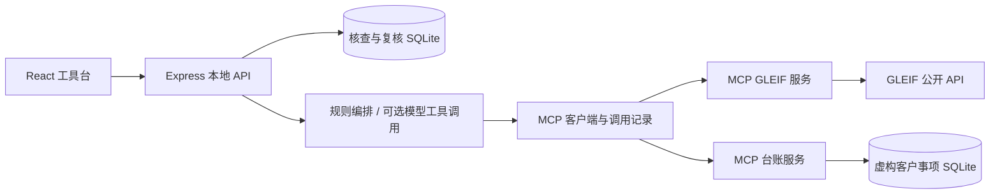

# 简要方案：收案前主体与潜在利益冲突核查

## 1. 谁在什么时刻使用

目标用户是负责新事项登记的律师、收案人员与复核合伙人。使用时刻位于接受委托之前：客户提供了一个对方企业名称，律所需要确认是哪家法律实体，并检查它与本所已有客户事项记录是否有关联。

目前问题不是缺少一份 AI 生成的“风险结论”，而是核查过程容易遗漏：名称不准确、不同公司简称相同、集团关系不易看见、公开记录与内部台账分散、人工排除理由没有留痕。

产品让“确认主体 → 获取线索 → 律师判断 → 留存依据”在同一条工作流内完成。

## 2. 为什么选这个场景

它有明确的律师工作入口，也自然需要连接两个来源：外部身份信息和内部客户事项系统。连接器不是摆设；每个来源都决定核查结果的完整性，断开某一来源会真实影响执行。

此前在 Alta Lex 测试账户及已查看的文档中，看到了研究、合同审阅、起草、批量文档、项目与知识库等能力，未发现对应的收案核查入口。本方案从这一观察提出可补充的工作流，不声称了解其全部版本、内部路线图或未开放功能。

## 3. 三个主要界面

### 连接器管理

- GLEIF：说明公开身份与上级关系的用途、传出字段和覆盖限制。
- 律所示例台账：说明本机只读访问、虚构数据性质。
- 每个连接器支持连接、测试、断开，展示实际发现的工具与连接状态。
- 模型未配置时明确标识，仍可用规则预览验证工作流。

### 新事项核查

- 输入事项名称、拟委托人背景、待核查对方企业及角色。
- 检索后展示候选实体的法律名称、LEI、地区和地址；用户确认后才能启动。
- 核查范围、使用的数据源和运行方式在启动前可见。
- 近似名称不能直接变成“确认主体”，避免把两个不同法人混为一谈。

### 结果与人工复核

- 区分主体直接命中、上级企业命中与名称近似线索。
- 同时提供公开关系、内部事项上下文、证据链接及真实工具调用记录。
- 律师记录进一步复核或排除，并填写理由；状态可撤回为待复核。
- 报告保留运行方式、范围缺口、数据取得时间与人工判断。

## 4. 数据与判断分层

| 层 | 回答的问题 | 本原型如何处理 |
| --- | --- | --- |
| 身份 | 对方究竟是哪家法人？ | GLEIF 查询候选，人工确认 LEI |
| 公开关系 | 是否有披露的直接或最终上级？ | 读取实际 GLEIF 结果并留来源 |
| 内部关系 | 是否匹配本所已有记录？ | 只读查询虚构 SQLite 台账 |
| 线索整理 | 命中依据与缺口是什么？ | 确定性匹配；可选模型基于工具结果整理 |
| 职业判断 | 本事项是否存在冲突、能否承接？ | 由律师依据适用规则和完整事实判断 |

LEI 精确命中是身份匹配证据，不是利益冲突法律结论。名称匹配须进一步确认。集团关系本身也不足以认定冲突。不同司法辖区的职业规范不能无差别混用；引用的官方资料及适用范围见 [研究文档](RESEARCH.md)。

## 5. 架构与真实 MCP 路径

两个 MCP 服务分别以 stdio 运行。宿主执行初始化与工具发现，再通过 MCP `tools/call` 调用。前端不直接调用 GLEIF，也不读取台账文件。SQLite 台账工具是第二个真实工具；其数据仍明确属于示例，不能把它描述成已经接入真实律所管理系统。

可选模型采用支持工具调用的接口。模型调用经后端白名单转发至同一套 MCP 工具；未配置时不伪造模型消息。配置了模型也须完成真实运行验证，才能勾选题目的 AI 调用要求。

## 6. 两天范围与取舍

| 本次完成范围 | 本次不扩张的部分 | 理由 |
| --- | --- | --- |
| 一个对方企业、直接及最终上级 | 任意自然人、多当事人、集团全图 | 把身份确认和证据链做完整 |
| LEI 与名称线索匹配 | 通用实体解析、跨语言别名大模型 | 原型保留可解释、可复核边界 |
| 公开企业源＋本机台账 | CRM、文档库、邮件多系统接入 | 避免 OAuth 与账户申请拖慢核心流程 |
| 单用户本机持久化 | 团队审批、SSO、多租户、生产审计 | 原型无需建设完整律所平台 |
| Markdown 核查报告 | 正式法律意见、自动收案决定 | 与测试目标及判断责任相符 |

没有采用完整 yente/OpenSearch 服务栈或整个文档管理平台。先学习身份匹配、来源展示、人工复核与工具管理设计，再用最小实现证明核心流程。这样安装路径短，评审者可以独立复现。

## 7. 实施顺序

1. 固定场景、数据边界和演示样例，先确认外部 API 能访问。
2. 验证真实 MCP 初始化、工具发现和调用，确定前后端共享合约。
3. 制作连接器、主体确认、核查结果三段交互，打通持久化。
4. 检查误匹配、无结果、断开连接、外部请求失败与人工复核。
5. 如有模型 API，完成模型真实工具调用；未完成则保留明确缺口。
6. 从干净安装复测，整理说明与来源，录制实际操作视频，再交付 GitHub。

## 8. 未来怎样融入 Alta Lex

建议在 Project 创建之前增加“收案核查”入口，完成复核后由律师决定是否继续创建项目。原型保持独立运行，未来可以复用 Alta Lex 的组织、用户和项目上下文，而不是重复建设整个产品。

接入层替换点包括：示例台账连接器替换为律所 CRM/Practice Management 连接器；本地环境配置替换为组织级凭据保管；连接器读取权限与项目权限联动；人工复核改为可配置的合伙人审批。原型已有的工具结果、调用记录与复核记录可以作为项目关联对象保存。

上线前还需要租户隔离、细粒度权限、密钥管理、保留策略、审计不可篡改、模型数据使用政策与真实用户验证。这些是未来集成工作，不是本原型已具备的能力。
