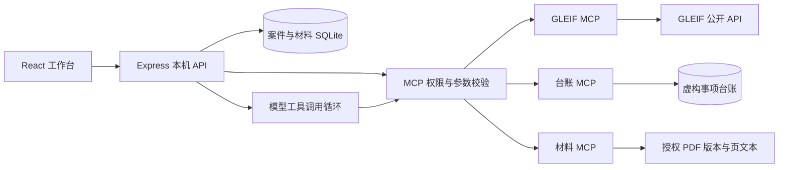

# 简要方案 · 律师收案审查与 MCP 工具台

当前实现 v0.9.1；整理于 2026-11-01。设计过程见 [方案历史](history/PROPOSAL-HISTORY.md)。

## 用户与问题

目标用户为负责收案的律师、助理和复核合伙人。在接受新事项前，核对拟委托人、交易对方等主体身份，查看是否命中既有事项，并补齐委托范围、集团边界和保密义务的核实材料。

公开企业信息、内部台账与委托文件分散，查询命中后仍有追溯、补证与记录工作。本产品连接“身份确认 → 工具取证 → 材料核对 → 人工审查 → 交接导出”，为律师保留实际来源和处理过程。

## 产品范围

案件工作台与审查总览为入口，一案最多六个企业。连接器页面管理 GLEIF、示例台账、案件材料三个 MCP，工具台独立展示参数、权限、返回与失败原因。

案件内包含匹配解释、潜在线索、补证、文本 PDF 与版本。AI 通过受限工具读取已确认主体或授权材料，提出带来源的行动与草稿；律师核对原文、编辑采用。材料更新保留旧依据，使受影响问题待复核，最后导出 Markdown 或 Word 交接文件。

大屏聚合已有案件和留存调用，不生成业务增长或法律风险评分。“记录完备”只描述当前记录，是否承接委托由律师决定。

## 技术实现

React／Vite 前端，Express／Node 24 SQLite 后端；官方 MCP TypeScript SDK 经 stdio 运行独立服务。记录实际调用的参数、来源、状态、耗时、发起方与错误，区分模型、规则和人工调用。

GLEIF 使用有限超时预算、IPv4 优先与有限重试；失败保留，不用预设结果替换请求。详见 [修复说明](GLEIF-RECOVERY.md)。

## 实现取舍

- 真实外部 GLEIF，加本机台账与材料工具；内部事项及内置 PDF 全部虚构。
- 覆盖 LEI 企业与已披露会计合并母公司，不覆盖全部集团成员、自然人或实际控制人。
- 支持带文本 PDF，不做 OCR、DOCX 导入或字符坐标批注；保留页码、版本与连续摘录校验。
- AI 只读本案授权范围，提出建议和草稿；引用存在不等于法律判断正确，采用与意见由人工处理。
- 单机单用户、本地持久化；未实现多租户鉴权、真实审批、消息外发或生产部署。
- 代码、方案、复用说明、验收、协作摘要与可见原始聊天脱敏导出已提供；新版视频按最新指示暂缓，评审访问待确认。

## 未来融入 Alta Lex

不依赖或修改 Alta Lex 源码。未来可将连接器目录、工具详情、权限和调用记录作为平台工具管理模块，将案件工作台作为一个 Agent 场景入口。

需要接入平台用户／租户／案件权限，将本机台账替换为律所系统连接器，将材料引用映射到平台文档版本。受限工具循环、来源凭证与人工采用流程可复用，具体接口需与平台团队确认；当前未实际集成 Alta Lex。

选题基于此前测试账户和已看文档中未发现同类收案入口的观察，不据此断言平台所有版本均无此能力。

## 复用与验收

直接使用 React、Vite、Express、Zod、Lucide、PDF.js、docx、diff 与官方 MCP SDK；业务代码在本仓库实现。参考项目用于研究和设计，不将参考当作实际集成。见 [研究](RESEARCH.md)与[第三方说明](THIRD-PARTY-NOTICES.md)。

当前验收以 [交付清单](DELIVERY-CHECKLIST.md) 为准；历史模型记录保留日期，配置状态或 mock 不替代实跑。
