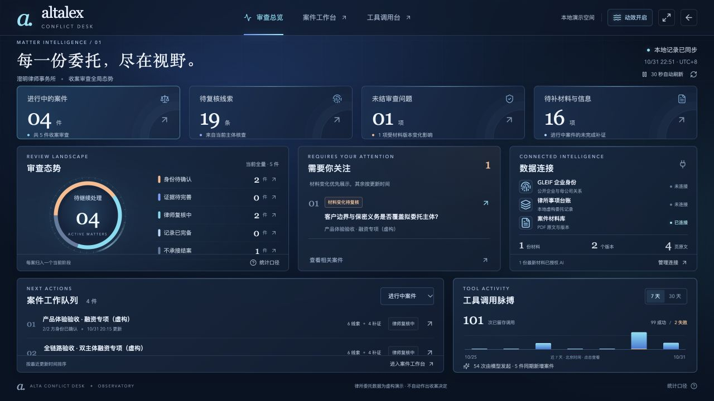
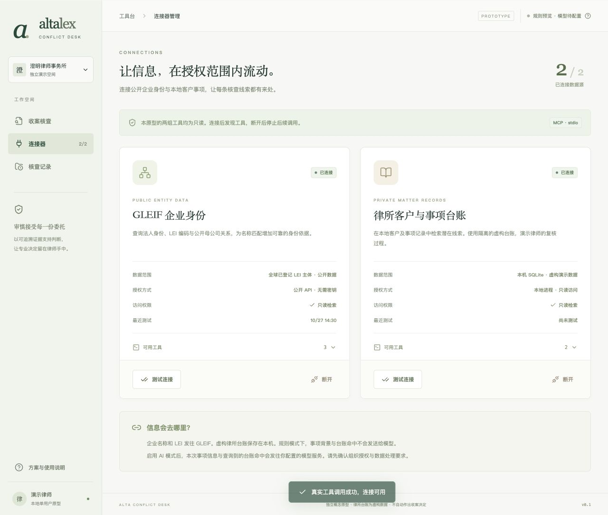
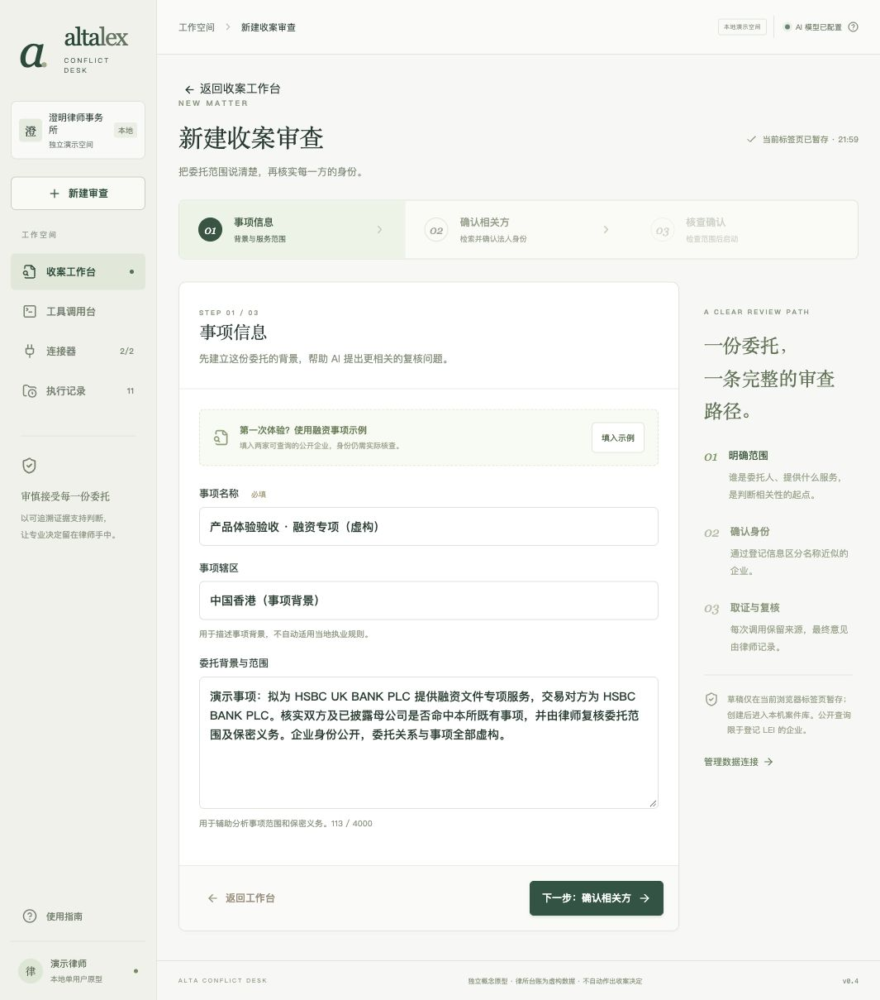
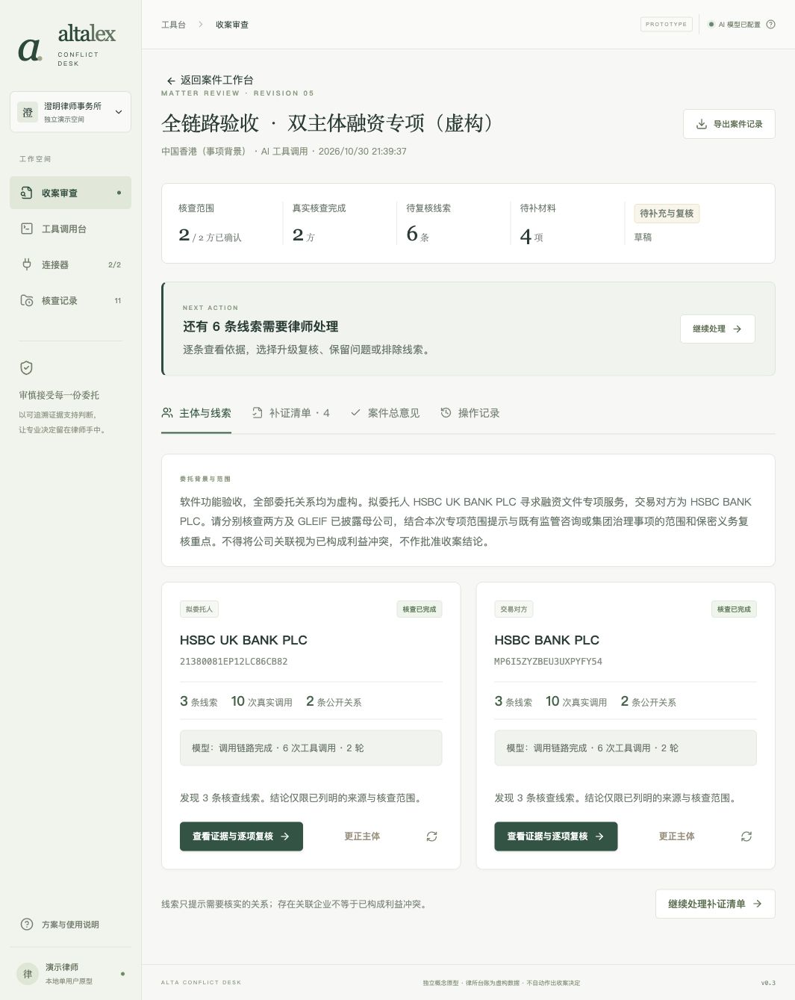
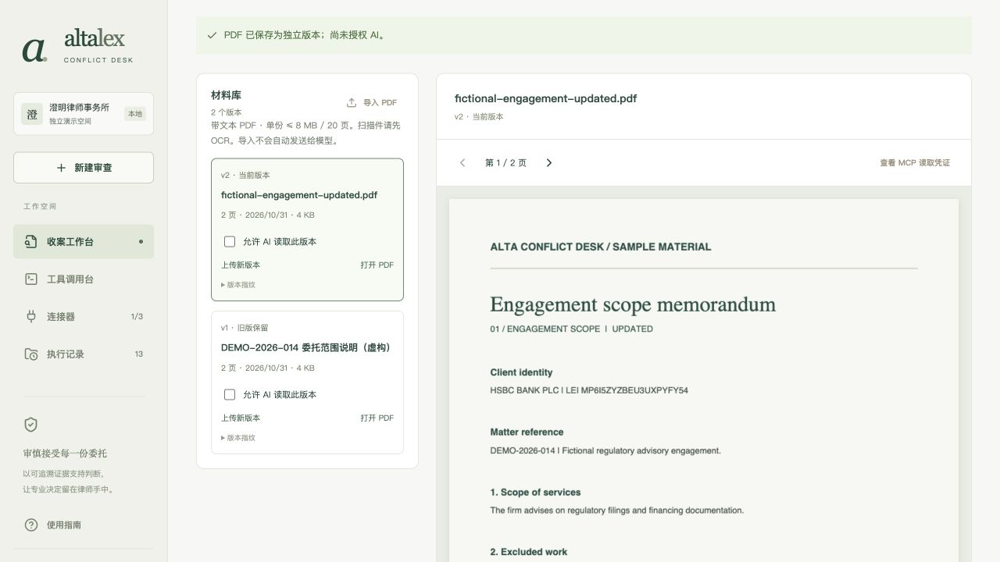
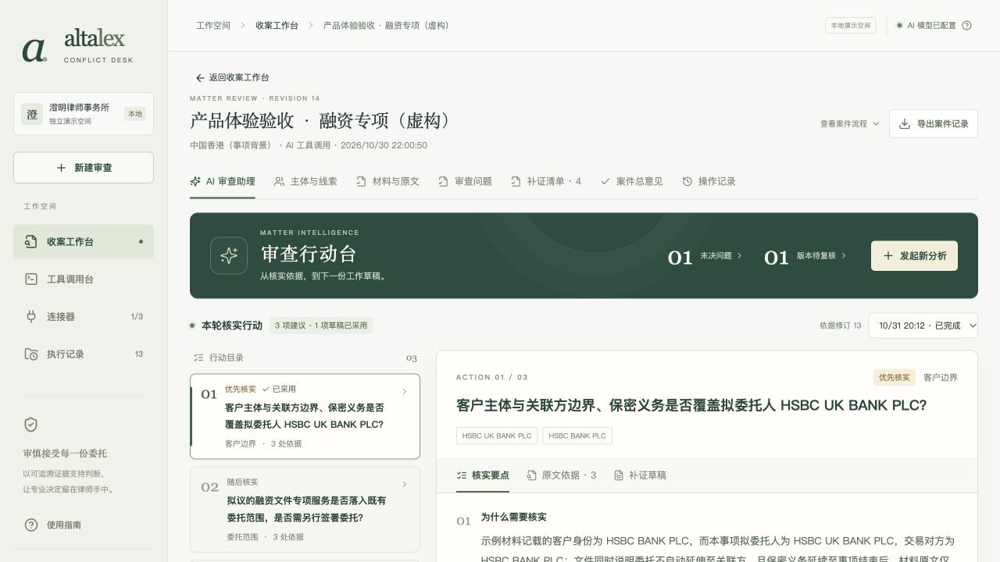
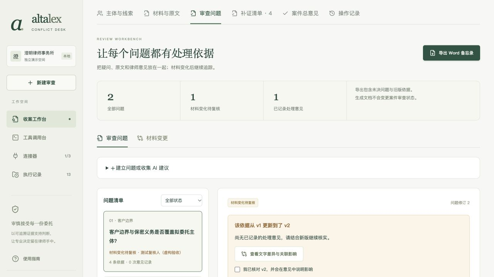
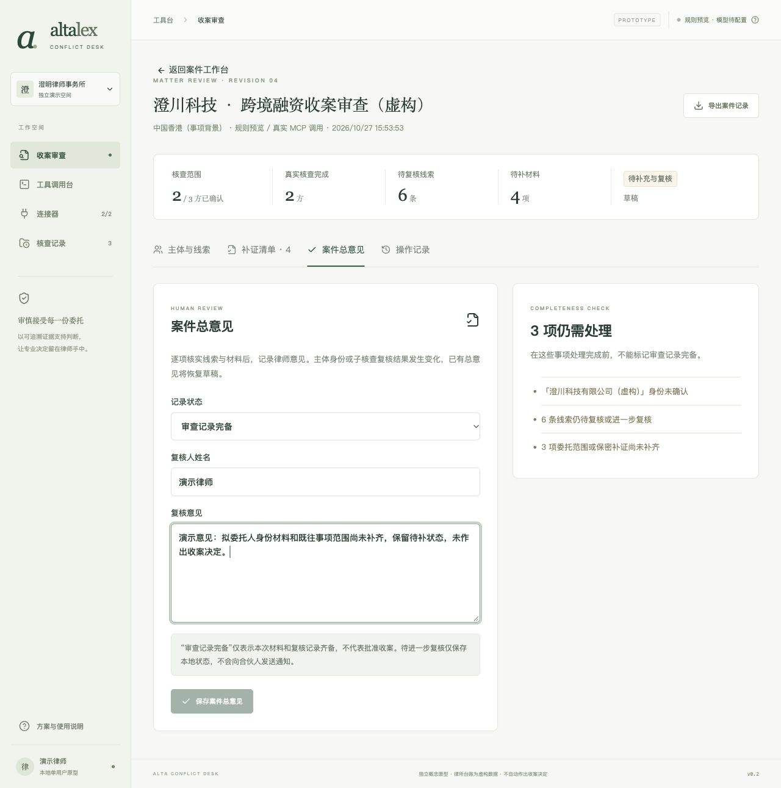

# Alta Conflict Desk 使用说明

这是一套供律师演示**收案前核查**的本机工具。它把企业身份、律所客户与事项台账、委托材料放在同一案件中，留下工具调用、材料引用和人工复核记录。系统提供线索和工作草稿；是否承接委托，始终由律师依据实际材料和执业规则判断。

本说明按一宗虚构融资事项讲解。可以先看下图认识「审查总览」，再按第 1-7 步操作。普通页面右上角的「7 步教程」也能逐步提示；首次进入收案工作台会自动出现一次，关闭后可再次打开。审查总览右上角用问号图标打开教程。

*图 1｜当前审查总览截图。数字来自截图当时的本机演示记录；新安装后以你的页面为准。*

## 开始前：启动与数据边界

1. macOS 可双击项目根目录的「启动原型.command」。首次运行需要 Node.js 24 或以上；脚本会在缺少依赖时安装依赖。也可以在项目目录执行 npm ci、npm run dev。
2. 保持启动窗口运行，在浏览器打开 <http://127.0.0.1:5178/>。左侧可进入「收案工作台」「连接器」「工具调用台」「执行记录」。
3. GLEIF 企业身份查询需要能访问互联网。三个 MCP 连接器本身不要求额外账户或密钥；其中律所台账和内置 PDF 是虚构演示资料。
4. 真实 AI 功能另需在本机配置支持工具调用的模型。全新下载的代码不包含模型密钥和已有案件。若模型未配置，先用「规则核查」体验主体查询与人工复核；材料 AI 建议需要模型，配置方法见[运行说明](OPERATIONS.md#可选模型配置)。

> 请只使用演示资料。导入的 PDF 保存在本机；只有逐版本授权并启动材料 AI 分析后，选中的原文才会发给本机配置的模型服务。企业名称和 LEI 会用于 GLEIF 公开查询。

## 跟着做一宗演示案件

### 1. 连接三个资料来源

从左侧打开「连接器」。找到「GLEIF 企业身份」「律所客户与事项台账」「案件材料与原文」三张卡片，逐张点击「连接数据源」。连接成功后，卡片会显示「已连接」；再分别点击「测试连接」，确认工具可用。卡片里的「可用工具」可展开查看实际发现的 MCP 工具。

GLEIF 提供公开登记与公司关系；律所台账在本机，用虚构客户和事项模拟内部检索；材料连接器读取本案导入的 PDF。三个工具均以只读方式查询。每次重启原型后，需要重新建立 MCP 连接；已经保存的本机案件记录仍会保留。

*图 2｜历史操作截图，当前界面、配色及连接器数量可能不同；请以页面上的三张连接器卡片为准。*

**如果连接失败：**先看卡片上的错误信息，再尝试「测试连接」。GLEIF 查询依赖外网；本机连接器失败时可重启原型后重新连接。「已连接」只代表工具接入，不代表某次企业查询已经成功。

### 2. 建立一宗收案审查

点击左侧「新建审查」。新建页面分为「事项信息」「确认相关方」「核查确认」三个小步骤。

1. 在「事项信息」点击「填入示例」，检查自动填入的事项名称和委托背景，并填写**事项辖区**。事项名称与辖区都是继续操作的必填项；辖区仅描述背景，不会自动套用当地执业规则。
2. 点击「下一步：确认相关方」。对每个相关方点击「查询身份」。在候选结果中核对**登记名称、辖区和 LEI**（法人机构识别编码），确认是本案要查的法律主体后，再点击「确认此主体」。还可用「添加相关方」扩大范围，最多 6 方。
3. 至少确认一方后，进入「核查确认」。选择「规则核查」或「AI 辅助核查」，核对本次数据流向，再点击「创建案件并核查」。模型未配置时，AI 选项不可选。规则核查仍会真实查询 GLEIF 与本机台账，但不调用模型服务。

*图 3｜历史操作截图，当前界面和配色可能不同；「填入示例」只填表，主体身份仍须实际查询并确认。*

创建后会进入案件页，并显示各方核查进度。未确认的相关方仍留在案件里，形成待补身份项，不算完成核查。若候选列表为空，可以修改名称或 LEI 后重查；**查不到不等于企业不存在**。

### 3. 检查主体线索和 MCP 调用

案件页的「主体与线索」会显示每一方的身份、线索数量、真实调用次数和公开关系。点击某张主体卡片上的「查看证据与逐项复核」。

先看「线索与复核」：直接命中、关联主体和名称近似是不同类型的提示。逐条打开线索，核对涉及的内部事项、公开关系、来源范围和资料缺口。再看「调用记录」：这里可以检查 MCP 工具名称、请求参数、返回内容、时间和失败原因。模型模式下，还应核对记录中是否确有模型发起的工具调用，不能只凭页面写着“AI”就当作已调用。

*图 4｜历史操作截图，当前界面和配色可能不同；截图中的案件与数字仅是当时的演示记录。*

对每条线索填写「复核说明」，再按实际情况选择「标记进一步复核」「排除此条线索」或「已复核，保留问题」。这些动作只保存本地复核状态，不会通知他人。名称相似或存在集团关联本身都不能直接证明利益冲突；“未发现线索”也只针对本次已检索的来源。

### 4. 导入并核对委托材料

回到案件，切换到「材料与原文」。若页面提示材料工具未连接，点击「连接材料工具」。可以点「导入虚构示例」体验，或点「导入 PDF」选择自己的演示文件。左侧列出材料版本，右侧显示 PDF 和本页提取文字；翻页时可用「查看 MCP 读取凭证」核对读取记录。

*图 5｜历史操作截图，当前界面和配色可能不同；左侧勾选框控制的是该材料版本的 AI 读取授权。*

如果后续要用模型分析，勾选材料卡片的「允许 AI 读取此版本」。授权按**版本**生效；「上传新版本」后，旧版本和旧引用保留，新版需重新授权。文件导入本机时不会自动发送给模型。

需要留下手工依据时，在阅读区展开「记录本页复核依据」，从本页提取文字复制**连续原文摘录**，填写核实说明，可选关联补证项，最后点「保存复核依据」。保存依据不等于补证已经完成。

**文件限制：**支持可提取文字的 PDF，单份不超过 8 MB、20 页。扫描件应先完成 OCR；本原型不处理加密 PDF，也不直接导入 DOCX。

### 5. 把材料整理成核实建议

这一步需要已经配置可用模型，并且至少有一份已授权材料。切换到「核实建议」，点「发起材料核实」，在「希望助理帮你做什么」中写清本轮问题，勾选材料，再点「生成核实建议」。单轮最多选择 4 份材料、合计 12 页。模型会读取本案背景、主体、问题和所选原文；界面显示调用次数和本轮状态，可以离开后再回来查看。

*图 6｜历史操作截图，当前界面和配色可能不同；截图展示已完成的演示建议，不能代表新案件会自动有结果。*

结果出现后，先点建议中的引用，核对**材料版本、页码、摘录和 PDF 上下文**。引用通过校验只说明摘录来自实际读取的页面，不代表模型的法律判断一定正确。随后点击「编辑补证草稿」，修改「待补材料与信息」和「补证请求正文」，再点「采用为审查问题」。采用后会带入问题与引用，但不会自动发送补证请求、解决问题或确认收案。

如果「生成核实建议」不可点击，检查模型是否配置、材料工具是否连接、版本是否授权、是否选中材料，以及是否超过 4 份或 12 页。规则核查不会生成这一步的材料 AI 建议。

### 6. 处理审查问题、补证和材料变更

切换到「审查问题」。可以在「建立问题或收集 AI 建议」里手工输入新问题并点「建立问题」，也可以从已有补证或 AI 建议带入。选中一个问题后，填写问题类别、责任人、相关主体、仍需补充的信息和「律师工作说明或处理意见」。在「添加原文依据」里选择材料版本与页码，核对原文后加入连续摘录，点「关联此依据」，最后点「保存问题记录」。

*图 7｜历史操作截图，当前界面和配色可能不同；右上角「导出 Word 备忘录」入口仍在审查问题页。*

若要把问题标为「已记录处理意见」，需有责任人、原文依据、至少 10 字处理说明，并先处理待补信息。切到「补证清单」，在相关待办里填「核实结果 / 补充说明」及「材料引用」，再点「保存并标记已补充」。系统管理的身份或来源缺口不能手工消除，要回到「主体与线索」补录身份或重新核查。

材料有新版本时，在「审查问题」内切换「材料变更」，选旧版、新版，点「读取并比较」。先看逐页文字差异，再打开受影响的问题，确认旧意见是否仍有依据，必要时关联新版摘录并重新保存。页面重排时，页码对应关系仍需人工核实；旧总意见会恢复草稿，文字保留供复核。

### 7. 记录总意见并导出交接文件

切换到「案件总意见」，在「记录状态」选择草稿、待补充材料、待合伙人进一步复核、审查记录完备，或不承接并结束审查。填写复核人姓名和复核意见，再点击「保存意见草稿」「保存案件总意见」或「记录不承接并结束审查」。非草稿状态需要填写复核人和意见。右侧「记录完整性」会列出阻止标记“审查记录完备”的事项；不承接时仍会保留未完成缺口。

*图 8｜历史操作截图，当前界面、配色及状态选项可能不同；以当前「记录完整性」提示为准。*

“审查记录完备”只表示本轮材料和复核记录齐备，**不代表批准收案**。「待合伙人进一步复核」也只保存本地状态，不会自动发送通知。之后可打开「操作记录」查看本案的更正、重跑、材料与意见变更。

需要交接时，案件标题右上角的「导出案件记录」下载文字版 .md；「审查问题」页右上角的「导出 Word 备忘录」下载可编辑 .docx。Word 中的后续修改不会自动回写案件，导出也不会改变审查状态。

## 常见问题与其他页面

- **网页打不开：**确认启动窗口还在运行，并重新打开 <http://127.0.0.1:5178/>。关闭终端会停止本机服务。
- **GLEIF 查不到主体：**检查名称或 LEI，再看调用记录是否超时或报错。没有返回匹配，不等于企业不存在。
- **看不到 PDF 原文：**确认材料工具已连接、文件可提取文字。扫描件需先 OCR；材料最多 8 MB、20 页。
- **AI 按钮不可用：**检查本机模型配置与材料逐版本授权。全新下载的代码没有模型密钥；规则核查仍可运行。
- **保存后状态没变成完成：**核对是否还有未确认主体、待复核线索、待补材料或审查问题；「案件总意见」右侧会列出阻止项。
- **想单独试工具：**打开「工具调用台」查看参数、结果和失败原因。手工试查属于手工调用；模型实际发起的调用应到案件核查记录核对。「执行记录」则用于找回历次主体核查。

这是一套单用户本机原型。内置律所台账和示例 PDF 的内容均为虚构，GLEIF 使用真实外部公开数据。正式处理真实委托前，还需确定组织权限、保密和模型数据授权要求。
