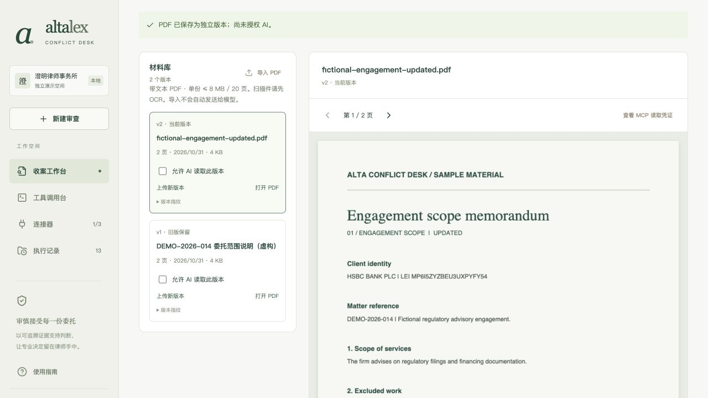
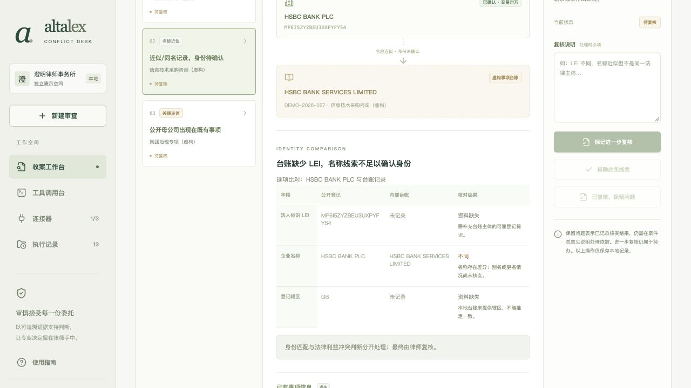
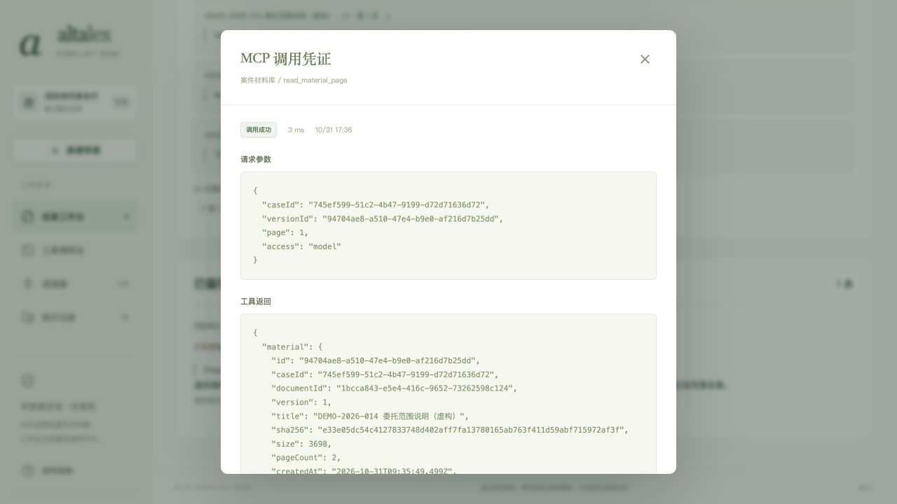

# v0.5 · 让收案复核回到具体材料

2026-10-31。本轮延续“新事项收案与潜在利益冲突核查”，目标用户仍为经办律师与复核合伙人。解决两个具体问题：为何匹配到这家企业；核实委托范围时，到底依据哪一版、哪一页材料。

## 已实现的工作流

1. 主体线索逐字段显示 LEI、名称、登记辖区的相同、不同或缺失。台账没有辖区则明确缺失；没有相似度百分比或自动冲突结论。母公司匹配明确比对的是母公司。
2. 案件内新增“材料与原文”。PDF 实际导入本机、由独立子进程解析并按页保存，浏览器显示原 PDF 页面和提取文字。扫描件、损坏或加密文件明确失败；不生成假的提取结果。
3. 第三个 stdio MCP 服务提供 `materials_info` 和 `read_material_page`。连接管理支持发现、测试和断开；全局工具台可以管理权限，案件原文读取必须在案件工作流发起。
4. 每个不可覆盖的版本拥有独立 UUID、SHA-256、页数、创建时间与 AI 授权。AI 读取由后端注入当前案件范围，模型只提供允许版本及页码。读取前后以及模型返回后复查授权。
5. AI 必须通过 MCP 读取全部选定页，输出带引用的待核实问题。程序逐条验证案件、版本、页码、真实调用编号和连续原文摘录；未通过则保留失败记录，不发布问题列表。
6. 点击引用定位对应版本及页码，在提取文字中高亮摘录。律师写明核实说明，可关联现有补证项；保存不会自动完成补证。材料替换保留旧引用、撤回同文档旧授权，新版默认未授权，关联任务重新待处理，旧总意见恢复草稿并保留历史。
7. 案件报告包含版本哈希、已保存摘录、AI 引用和实际 MCP 调用记录。读取错误有重试入口；凭证注明版本授权状态是当时快照。

## 实际验收

在既有虚构案 `745ef599-51c2-4b47-9199-d72d71636d72` 上通过浏览器完成：连接材料工具、导入内置原版 PDF、按版本授权、实际 DeepSeek 运行、引用定位、保存关联补证的摘录、通过文件选择器上传修订版、回看旧引用，以及下载案件报告。

- 模型 `deepseek-flash`，2 轮交互，2 次模型发起且成功的 `read_material_page` 调用，覆盖两页；生成 5 个待核实问题。没有将手工看页计入模型调用数。
- 原版仅含银行监管申报，明确排除融资文件；修订版增加融资文件服务，谈判仍不在范围内。两版 SHA-256 不同，旧摘录仍回到原版第 1 页；替换后两个版本都未获 AI 授权。
- 只读脚本核验所有文件哈希、原文引用与工具返回，以及每份选定文件的所有页是否实际读取。运行时不读 `.env`、不发起网络或新模型请求。证据见 [V5-MATERIAL-VERIFICATION.json](evidence/V5-MATERIAL-VERIFICATION.json)；它是应用记录验证，不是服务商账单核验。
- 保存了 1 条明确标注虚构验收的人工摘录，关联 `DEMO-2026-014` 补证项；没有填写收案批准意见。案件仍有 6 条线索和 4 项补证待处理。
- 浏览器实际下载 [案件报告](evidence/V5-CASE-REPORT.md)。桌面材料阅读与字段表格已查看；390px 下匹配页、材料库和原文阅读器文档宽度均为 390px，无整页横向溢出。测试后已恢复默认视口。
- 文件选择器自动化第一次因节点失效失败，重试后真实上传成功；该步骤自动化耗时异常，不将其视为产品响应时间。材料在交给服务后正常入库。
- 53 项自动测试通过，包括五项新增材料/匹配测试组。mock 模型测试专门覆盖伪造引用、跨案访问、访问模式冒用、全局绕过、权限撤回、全局工具暂停、旧意见与版本保留；真实模型结果单独计证。
- TypeScript 与生产构建通过。构建有 Zod 上游注释位置提示，Rollup 会移除该注释；无构建失败。依赖更新后的 npm audit 报告为 0 项漏洞，此结果限本次扫描。

## 范围与取舍

- 仅带文本 PDF；单份 8 MB / 20 页，每案最多 30 个版本，单轮模型最多 4 份 / 12 页、16 次工具调用。不支持 OCR、DOCX、表格结构还原、字符坐标批注或通用知识库。
- PDF 原文页由 PDF.js 渲染；摘录高亮在提取文字中，不是 PDF 页面上的框选批注。PDF 原文始终优先于提取文本。
- AI 问题语义仍可能过度推断；程序校验来源和摘录，不校验法律判断正确性。材料内文字作为不可信数据处理，但不宣称能彻底消除提示注入。
- 本机单用户原型，无账户系统、多租户或正式律师签名。案件范围限制约束服务端工具调用，不防拥有本机文件权限的人直接读库。原型无文件删除、配额后台或审计防篡改系统。
- PDF 导入本机并不等于授权 AI。启动复核会把本案背景、问题和授权版本页文本发送给配置的模型；撤回只阻止后续读取，不撤回已发送数据。材料页未保存的摘录说明在切换页前需保存。
- GLEIF 外部服务与台账链路保留原实现和 v0.4 验收，未重复请求。第三个连接器为真实本地文件工具，不包装成第二个云服务。

## 复用与未来接入 Alta Lex

直接采用 Mozilla PDF.js (`pdfjs-dist` 6.4.299，Apache-2.0) 的文本提取与渲染功能，MCP 继续使用官方 SDK。业务流程、案件边界、版本库、引用验证及 UI 为本项目实现，没有移植 OpenContracts 或 Alta Lex 的源码。两版虚构 PDF 由 ReportLab 生成，原型启动无需 Python。Zod 升级至 4.6.7 并完成兼容回归。见 [许可清单](../THIRD-PARTY-NOTICES.md)。

未来作为 Alta Lex 案件工作区中的侧栏/标签页接入，复用其用户、组织、事项与文件权限：由宿主签发包含用户、案件和授权版本的短期调用范围；将本地文件及 SQLite 替换为对象存储与正式数据库；沿用宿主模型网关及审计系统。材料 MCP 工具保留窄接口，由宿主验证身份与授权，不能信任模型传入的案件 ID。正式接入还需补齐恶意文件检测、OCR、数据保留策略和真实组织权限；本轮不将这些列为已实现能力。
