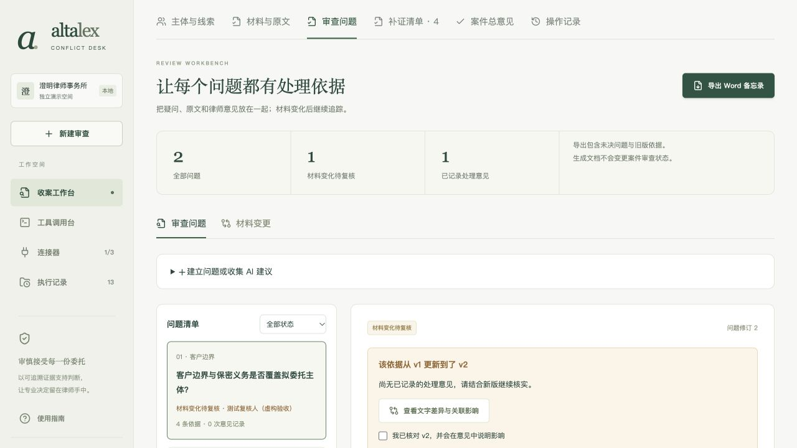
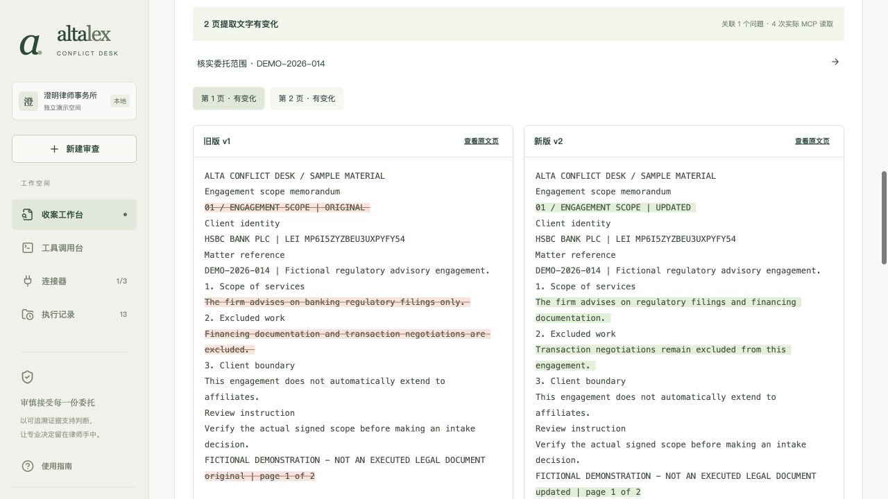
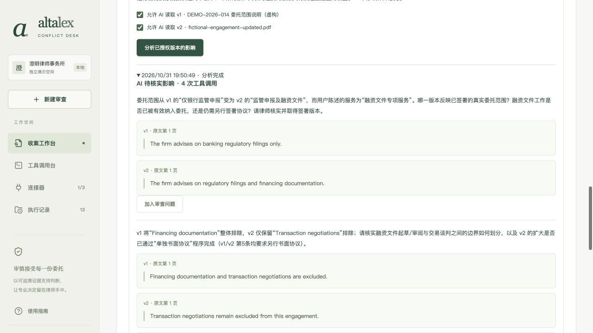

# v0.6 · 从核查线索到可交接的审查问题

> 历史验收记录：当时的 Word 功能和样本现已按用户要求移除；当前能力见[交付清单](../DELIVERY-CHECKLIST.md)。

2026-10-31。目标用户仍是收案经办律师和复核合伙人，场景仍为新事项收案及潜在利益冲突核查。本轮解决三个连续问题：每个疑问依据什么、材料更新后哪些记录要重新核实、怎样把当前工作交给复核人继续修改。

## 操作流程

1. 案件新增「审查问题」。手工建立问题，或把既有补证任务、已完成材料 AI 的具体建议加入清单。重复导入同一来源不会创建副本。AI 引用作为背景依据导入，不自动变成人工意见。
2. 问题可记录类别、相关主体、责任人、待补信息及处理说明。添加本案原文摘录，注明支持、矛盾或背景用途。后端校验版本、页码和连续原文；点击引用通过 MCP 读取并打开对应 PDF 页。
3. 记录处理意见要求责任人、至少一条原文、至少 10 字说明、待补信息已处理。系统保存当时的引用和版本指纹快照。该操作不自动完成原补证任务，也不批准收案。
4. 同一文档有新版本后，引用旧版且尚未确认新版的问题显示「材料变化待复核」。旧意见和引用保留；补充新版依据并勾选已核对影响后，才能再次记录处理意见。未决问题会阻止「审查记录完备」。
5. 「材料变更」通过 MCP 逐页读取两版原文，展示行级增删和引用旧版的关联问题。只有分别授权两个版本后，才可请求 AI 提出变更影响问题。调用凭证、版本、页码和实际引用均可查看。
6. 导出可编辑 Word 备忘录，包含事项范围、涉及主体、问题与处理说明、未决事项、原文版本及意见历史。导出读取当前保存记录，不更改案件状态；Word 中的修改不会回写系统。




## 实际验收

继续使用全为虚构委托关系的案件 `745ef599-51c2-4b47-9199-d72d71636d72`，没有创建真实法律意见或收案批准。

- 浏览器从既有任务建立问题，关联 v1 原文，进入变更对照；添加 v2 矛盾依据，填写明确标注软件验收的人工记录并确认新版影响。问题形成 1 次意见历史，总意见仍为草稿，原 4 项补证及 6 条线索没有被自动清除。
- DeepSeek `deepseek-flash` 最终完成 2 轮、4 次模型发起的成功 `read_material_page` 调用，覆盖两版各两页，生成 3 个待核实问题。成功记录 ID：`4ed65372-2601-42ad-9196-06207bbc9026`。手工看页和文字比较不计入模型调用数。
- 前两次真实尝试分别因 JSON 语法错误、遗漏 `traceId` 失败，均保留。修复为最终整理阶段启用官方 JSON 模式、明确提供实际凭证索引，并对语法/结构错误最多重试一次。引用内容或来源校验失败不会被静默修补。最后成功运行未触发格式重试；重试恢复及持续失败由 mock 回归测试覆盖，不混称为真实模型证据。
- 把成功分析中的客户边界问题加入工作台，保留 4 条 AI 原文引用，并人工整理标题、责任人及待补事项。当前共 2 个问题、6 条关联依据、1 次人工意见历史，其中 1 个问题继续待复核。
- [材料模型只读核验](../V6-MATERIAL-VERIFICATION.json)验证保存的模型结果、完整页读取与 PDF 哈希，包含 v0.5 和 v0.6 两次成功记录，合计 6 次工具调用和 8 个问题；**本轮新增成功记录仅为 4 次调用、3 个问题**。[问题只读核验](../V6-WORKBENCH-VERIFICATION.json)验证本案当前/历史引用及意见版本快照，并单列本轮三次模型尝试。这些是应用记录核验，不是服务商账单核验。
- 浏览器当时实际下载 Word 备忘录，随后通过独立 LibreOffice 渲染逐页检查中文、表格、页码和分页。样本后续已从仓库移除。预览环境最初未发现中文字体，使用仅本次进程的 fontconfig 配置读取系统宋体后恢复；没有改系统字体设置、在文档中嵌入或在仓库分发系统字体。
- 390px 宽度下检查问题清单、版本对照、原文弹窗，文档宽度均为 390px；修复复选框宽度及受祖先动画影响的弹窗定位，验证 Escape 关闭和凭证查看。检查后恢复默认视口。
- 59 项自动测试全部通过；包括案件/引用边界、旧修订冲突、版本变更后意见失效、重新复核的新版依据要求、AI 来源导入幂等、实际 Word 结构和格式重试上限。TypeScript 与生产构建通过；保留两条 Zod 上游 PURE 注释提示。依赖扫描为 0 项漏洞，仅代表此次扫描结果。



## 范围与实现取舍

- 这是已有收案工作流的深入实现，不是通用诉讼平台或自动法律意见系统。问题类别为委托范围、客户边界、保密义务和其他核实问题。
- 文字对照按提取页码和行完成，页面重排、表格结构、条款移动及语义等价需人工判断。变更提醒按「同一文档出现新版本」触发，尚不区分纯排版变更与实质变更。
- 不支持删除问题、撤回引用或更改已保存引用用途；可补充更正依据与说明，原记录保留。正式产品还应加入带理由的撤回、合并与审计。每案最多 50 个问题，每题最多 20 条引用。
- 对照的 AI 沿用材料引擎，每轮最多 4 份/12 页、16 次工具请求，5 轮上限；每次最终问题的引用均需校验。两版合计超过 12 页仍可人工对照，AI 会明确拒绝超限。
- Word 是可编辑的当前记录快照，无在线协同、修订回传、律所模板管理或正式电子签名。当前引用和材料索引随文输出；历史意见携带当时核对的版本编号，完整历史引用快照仍保存在应用及核验 JSON 中。
- 本机单用户原型，责任人姓名由用户输入、未认证；不是生产环境的身份、权限与审计方案。PDF 输入边界、版本授权和模型传输范围沿用 [v0.5](PRODUCT-EXPERIENCE-V5.md)。
- 本轮未重复外部 GLEIF 网络核查；先前 GLEIF/台账验收仍以原日期记录为准。新增对照使用真实材料 MCP，不把本地工具称为新增云服务。视频仍按用户要求暂缓。

## 复用与未来融入 Alta Lex

当时直接采用 `diff` 9.0.0（jsdiff，BSD-3-Clause）的 `diffLines` 实现行级增删，并使用 `docx` 9.15.0（MIT）生成 OOXML，`fflate` 0.8.3（MIT）检查其 XML；后两项现已移除。MCP 官方 SDK、PDF.js 与既有项目参考保持原范围，没有复刻 Alta Lex 源码。见 [当前依赖](../THIRD-PARTY-NOTICES.md)和[研究](../RESEARCH.md)。

未来可作为 Alta Lex 案件页的「审查问题」插件接入：使用宿主的 matter/document/version/user ID，接收材料版本更新事件，复用宿主身份与文件授权、模型网关、审批和审计；用正式数据库事务替换当前两份 SQLite 的业务更新。本地 MCP 的窄接口和引用校验可以保留。接入前需与宿主确认真实权限、版本事件、模板及模型保密策略，不能仅靠模型提供的案件编号授权。

## 复验命令

```bash
npm ci
npm test
npm run build
npm run dev
# 已有运行记录只读核验，无新增模型请求；新克隆需先建立案件。
npm run verify:materials -- <caseId>
npm run verify:issues -- <caseId>
```

源码和文档在私有 GitHub 交付。运行数据库与模型密钥不进仓库；当时的示例 Word 只含公开企业身份与虚构事项，现已移除。
