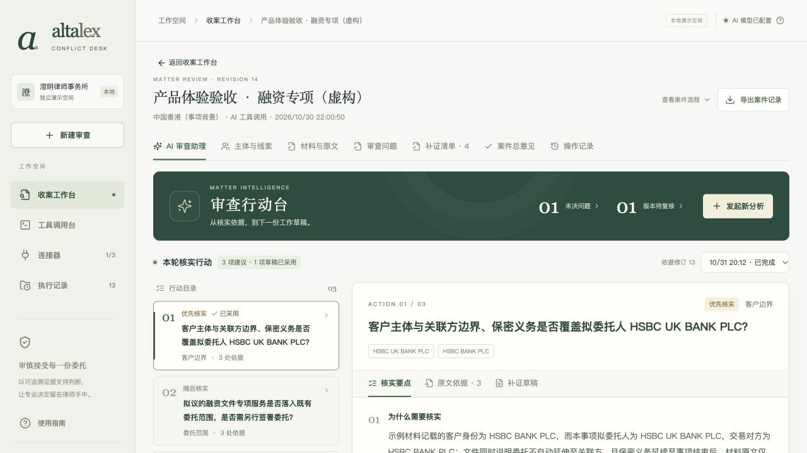
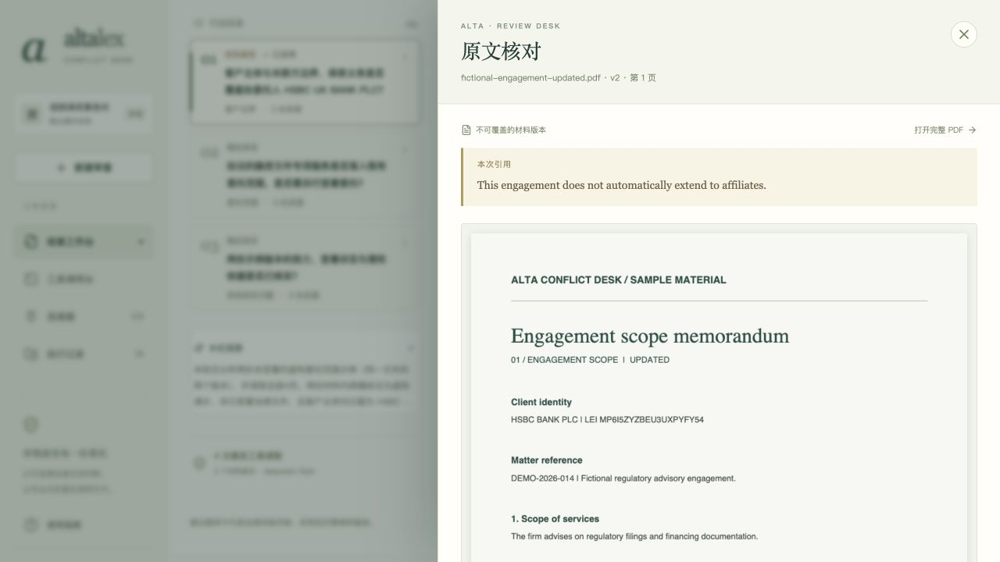
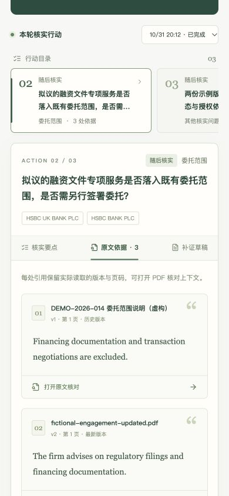

# v0.8 · 审查行动台的阅读与操作体验

2026-10-31。回应“显示上来一波改进”，本轮聚焦已有 AI 审查助理。目标用户仍是收案经办律师：快速判断先核实哪件事、依据在哪一页，以及下一份补证草稿怎么写。

## 页面变化

| 原有阅读方式 | 新的操作方式 |
| --- | --- |
| 案件抬头、进度、横幅占据较多首屏空间 | 紧凑抬头；案件流程按需展开；待核实问题与版本影响可直接进入问题页 |
| 行动内容沿长页展开 | 左侧行动目录，右侧展示当前行动；目录显示建议顺序、类别、引用数和已采用状态 |
| 理由、引用、表单混排 | 「核实要点」「原文依据」「补证草稿」独立切换，标题与关联主体保持可见 |
| PDF 页在小区域内阅读 | 大尺寸原文侧栏，明确当前引用、文件版本与页码，支持完整 PDF、提取文字和真实调用凭证 |
| 新任务设置持续占用阅读区域 | 点击「发起新分析」打开侧栏，选择目标和已授权材料后再开始 |

视觉沿用森林绿、暖白和少量金色，用编号、留白和文字层次组织内容；没有新增外部字体、图片资源或 npm 依赖。

## 实际交互检查

在既有虚构案件 `745ef599-51c2-4b47-9199-d72d71636d72` 中通过浏览器完成：

- 三项行动切换；核实要点、原文引用和补证草稿切换。
- 编辑第二项未采用草稿，切到第三项再返回，正文保留；测试后恢复原文，没有采用或修改案件。
- 第一项已采用草稿呈现先前实际编辑的正文，保持只读。
- 打开实际 PDF 对应页，浏览器渲染 canvas；查看本次读取凭证，展示真实 `read_material_page` 参数与返回。这些是人工触发的本地 MCP 读取，不计为新增模型调用。
- 侧栏 Tab／Shift+Tab 循环、Escape 关闭、焦点返回原按钮；新任务预设关闭再打开仍保留。修复了禁用读取按钮后焦点丢失的问题。
- 历史失败运行显示未完成、保留读取凭证和重试入口；切回成功运行恢复三项行动。
- 案件流程展开／收起，以及切换审查问题页再返回。
- 默认 1280px、1024px 平板、390×844 手机检查。手机行动目录可以内部横向滚动，整页宽度保持 390px，原文侧栏也是 390px；修复初次检查发现的 grid 最小宽度溢出，检查后恢复默认视口。
- 浏览器未捕获 error；62 项现有回归测试及 TypeScript／生产构建通过。保留两条已有 Zod 上游 PURE 注释提示，不影响构建。

## 实现与边界

复用 v0.7 的模型编排、MCP、权限、原文校验、版本失效和人工采用 API；本轮没有后端或 API 协议变更。将草稿编辑区提取为 `AssistantDraft`，沿用同一暂存键；新增 `ReviewDrawer` 使用原生 dialog、Portal、焦点循环和返回定位。响应式布局保留完整操作，窄屏行动目录改为横向浏览。

本轮使用 frontend-design 技能辅助设计与实现，没有复制 Alta Lex 源码或其他项目界面代码。未来仍作为宿主案件页插件嵌入；侧栏和行动目录可映射宿主设计系统，业务 API 的集成边界保持不变。

截图来自本机实际运行页面，展示 v0.7 已保存的真实 AI 结果；没有重新调用模型、制造新建议或批准收案。旧版真实模型证据见 [v0.7 核验](evidence/V7-ASSISTANT-VERIFICATION.json)。本轮不是全浏览器无障碍认证，视频按用户要求继续暂缓。
