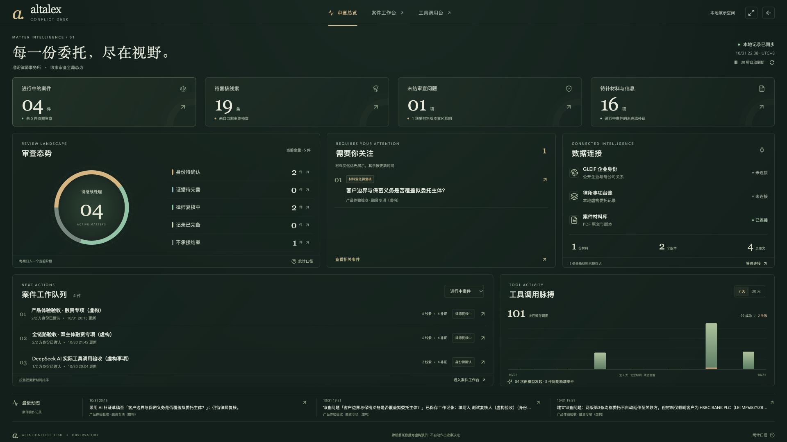
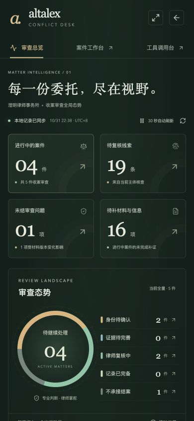

# v0.9 · 审查总览数据大屏

本轮针对“很好看的数据大屏”增加独立总览入口。服务对象是需要同时掌握多份收案工作的经办律师与复核人员：看见待办后直接进入案件，不增加自动法律结论或第二套案件系统。

## 呈现与操作

- 深墨绿、香槟金、衬线数字与克制的入场动效；原案件审查台仍保留原有浅色工作界面。
- 四项指标：进行中案件、待复核主体线索、未结审查问题、待补材料与信息。点击指标筛选下方队列。
- 阶段环图以五个互斥状态展示全部案件，点击图例筛选。没有虚构地域地图、风险评分、营收或增长率。
- 材料变化优先的关注清单，可进入对应案件的审查问题；连接器显示当前连接状态，材料数量来自真实本机版本库。
- 队列显示最近更新的最多四件案件；紧凑屏幕中列表内部可滚动，完整案件仍可进入工作台查看。
- 7／30 天工具柱状图，点击单日查看调用、失败和新增案件数；保留失败计数。
- 全屏切换、手动刷新与 30 秒自动刷新／暂停。请求失败时提示错误并保留上次成功快照，不以新时间冒充新数据。
- 1920×1080 展示完整大屏；1280×720 压缩为核心面板并隐藏动态摘要；390px 改为纵向阅读。小屏完整操作保留。

## 统计口径

案件与资产指标始终是当前全量快照。待办只计算进行中案件，已记录完备／不承接结案不混入当前待办。材料变化按问题 effectiveStatus 计入，即使原保存状态为 resolved，也仍需复核。

阶段先区分结案状态，再检查主体身份、当前核查完成度与失败／部分完成情况，其余进入律师复核。只使用各主体当前绑定的核查计算阶段和线索，旧尝试不会重复增加当前待办。

趋势时间按北京时间的自然日计算并包含今天。工具调用按真实 trace ID 去重，覆盖已保存的主体核查、材料分析、AI 助理与独立工具台；不覆盖没有留存的临时页面读取。历史成功和失败均保留。模型、规则、人工调用按原记录区分；没有把连接成功或读取总览算成新模型调用。

新增 `GET /api/overview?days=7|30`，不调用外部网络或模型，不更改权限；运行数据只在本机聚合。空库显示零和空态。正式融入 Alta Lex 时需由宿主限制可见案件范围，并将聚合迁移到分页查询或预计算统计；当前是小规模单用户原型，不承诺大数据量性能或多租户隔离。

## 实际验证

2026-10-31 的本机快照：5 件案件、4 件进行中、19 条待复核线索、1 个未结且受版本变化影响的问题、16 项待补信息；1 份材料、2 个版本、4 页。七天内已保存的调用为 101 次，99 次成功、2 次失败，其中 54 次标记模型发起。**这是此前历史运行的聚合，不是本轮新增实跑。** 保存的核对记录见 [V9-OVERVIEW-VERIFICATION.json](evidence/V9-OVERVIEW-VERIFICATION.json)。

- 浏览器验证指标联动、空队列、7／30 天切换、单日详情、暂停与恢复自动刷新、手动刷新、全屏进入／退出按钮状态、关注问题跳转及返回。
- 1920×1080 页面宽高均与视口一致；1280×720 核心面板一屏显示；390px 无整页横向溢出，30 根趋势柱仍可呈现非零数据。
- 开发服务重启后恢复了原已授权的材料 MCP 连接，未增加权限、未运行新分析；GLEIF 与台账的未连接状态如实显示。
- 新增三项测试覆盖结案排除、材料变化有效状态、调用去重、失败保留、北京时间跨日与窗口边界、未来记录排除、空库与非法参数。全量 65 项通过，TypeScript 和生产构建通过。
- 沿用已有两条 Zod 上游 PURE 注释构建提示，不影响输出。界面作为懒加载模块，不增加 npm 依赖或外部字体资源。

沿用 frontend-design 技能辅助实现；图表用原生 CSS／DOM，图标来自既有 lucide-react，没有复制新的开源项目界面。数据服务复用既有案件、问题、材料、工具记录。视频依用户要求继续暂缓。
