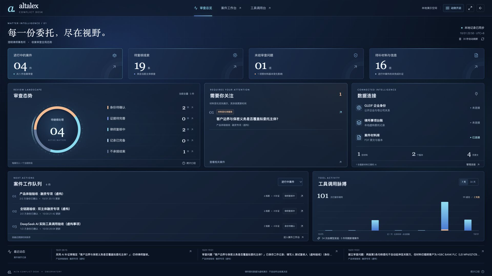
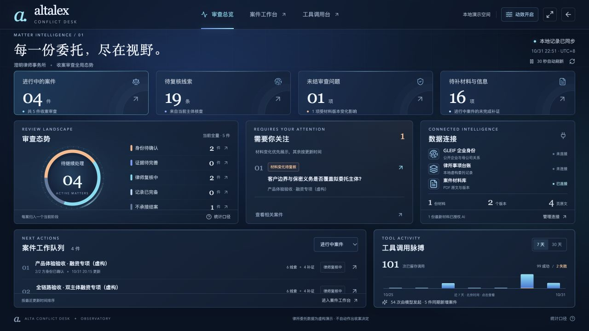
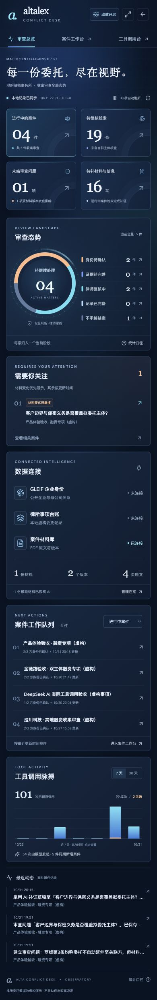

# v0.9.1 · 深海蓝动态大屏

2026-10-31，针对“颜色更好看、具有动态感”的反馈，更新已有审查总览，不改变案件处理流程和统计口径。

## 视觉与交互

- 深海蓝背景、分层蓝色卡片、冰青高光、暖橙待复核提醒，提高信息层次与文字对比。
- 背景光晕缓慢移动，环图外围的装饰刻度缓慢旋转；实际数据扇区位置与占比保持稳定。
- 指标卡依次入场、悬停轻抬升，7／30 天切换时柱图入场。定期数据刷新不会重复播放整组入场动画。
- 右上角“动效开启／关闭”只控制视觉效果，不影响数据刷新。选择保存在本机浏览器；系统开启减弱动态效果时跟随系统，页面进入后台时暂停动画。

新增样式独立放在 `src/overview-motion.css`，不新增依赖。沿用 React、Lucide 与已有 CSS 布局，不复制第三方仪表盘模板；本轮使用 frontend-design 技能辅助视觉实现。

## 实际验证

- `npm run build` 通过，包括 TypeScript 检查与 Vite 生产构建。保留依赖 Zod 的两条 PURE 注释警告，不影响构建。
- 浏览器观察到光晕动画运行、环图外圈变换随时间变化；关闭后相关动画为 none，刷新仍显示关闭，再开启恢复。
- 7／30 天切换及单日明细可用。30 天视图点击 10-30，显示已有记录的 58 次调用、2 次失败、3 件新增案件。
- 1280 × 720 桌面检查：文档宽高与视口一致，面板无内容裁切。390 × 844 手机检查：页面宽度 390，无横向溢出，顶部动效按钮可见。
- 留存 1920 × 1080 大屏、默认桌面、手机截图；检查后恢复默认视口。浏览器错误日志为空。
- 系统减弱动态效果通过媒体查询和偏好监听实现；本轮没有修改操作系统设置来模拟该偏好。

本轮为前端视觉更新，没有新模型调用、案件数据写入或后端变更。v0.9 的 65 项测试记录保留为历史结果，本轮未重复执行整套后端回归。动态效果请运行页面查看，PNG 只呈现静态外观。

